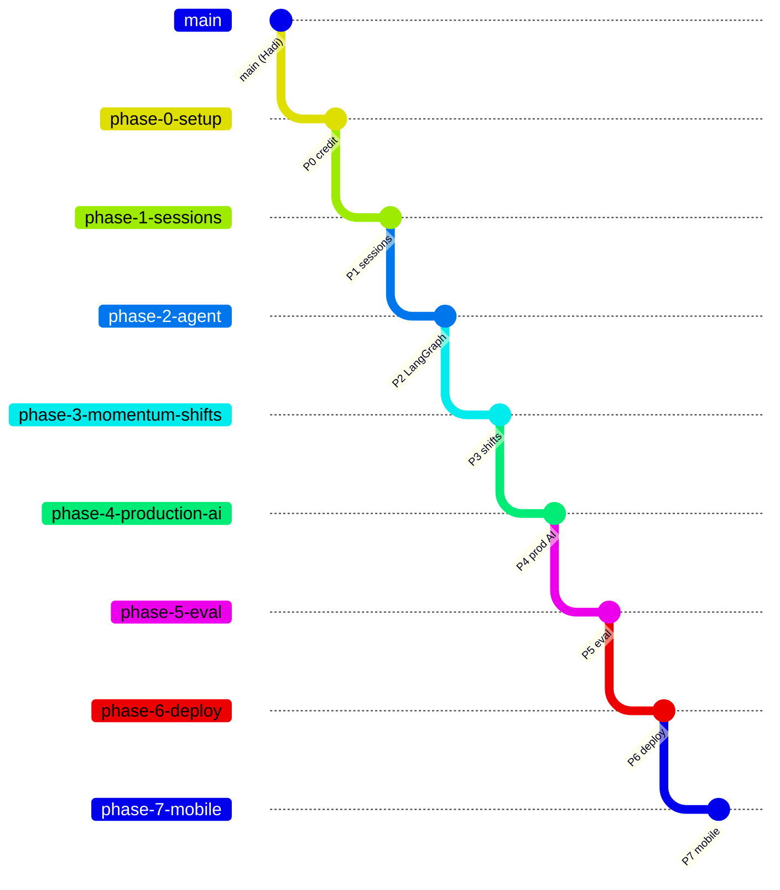

# Touchline+ build summary

Phases 0–7 of the build brief are done (Phase 8, the demo and launch, is yours). Every phase has its own branch, built on the previous one, with tests, file docs and a report.

> ## ⚠️ First thing to do: nothing has been pushed
> Every `git push` was refused with **HTTP 403**: Claude has no GitHub access to `fouratrachid/Inside-the-Game-Hackathon`. All eight branches exist **only in the session container**.
> 1. Reconnect GitHub at <https://claude.ai/connect-github> and make sure the Claude GitHub App is installed on the repository.
> 2. Then ask Claude in this session to push the branches, while the session container still exists. As a fallback, `touchline-plus-phases.bundle` is in the repository folder: `git fetch touchline-plus-phases.bundle 'refs/heads/*:refs/heads/*'` restores every branch.

## Phases at a glance

| Phase | Branch | Python tests | What it delivered | Report |
| --- | --- | --- | --- | --- |
| 0 — Setup and credit | `phase-0-setup` | 58 (baseline) | Touchline+ title, credit to Hadi Sotudeh, Changes list, docs scaffolding, chart generator | [phase-0](phases/phase-0.md) |
| 1 — Server-side sessions | `phase-1-sessions` | 65 (+7) | `session_id` in the first SSE event; `/chat` builds context from emitted events only; browser snapshot ignored; 404/409; TTL + LRU store | [phase-1](phases/phase-1.md) |
| 2 — LangGraph agent | `phase-2-agent` | 85 (+20) | Agent chooses among 7 tools (≤4 rounds); validator checks cited IDs and minute, one retry; Gemini/Foundry/Ollama; `GAME_AGENT=maf` keeps the original; tool trace in the UI | [phase-2](phases/phase-2.md) |
| 3 — Momentum shifts | `phase-3-momentum-shifts` | 91 (+6) | Causal shift detection (xT added, 0.03 gap held 3 min, 5-min debounce), explained by top actions and possession chains; `momentum_shift` SSE; chart markers; clickable notes light up numbered, animated chains on the pitch | [phase-3](phases/phase-3.md) |
| 4 — Production AI | `phase-4-production-ai` | 114 (+23) | Tracing (JSONL + optional Langfuse), RAG over 7 sourced definition files (Chroma, `lookup_definition`, cited sources), guardrails + injection suite, `/chat/stream`, cache, cost tracking and budget | [phase-4](phases/phase-4.md) |
| 5 — Evaluation | `phase-5-eval` | 120 (+6) | `python -m eval.run`: 36 questions, factual accuracy, citation validity, leakage, latency, tool calls, LLM-as-judge, human-grading CSV, Cohen's kappa; offline baseline; CI subset | [phase-5](phases/phase-5.md) |
| 6 — Deployment | `phase-6-deploy` | 125 (+5) | Dockerfile (verified: builds, healthy, works with no key), Render blueprint, Fly/HF notes, `GAME_SOURCE=both`, offline fallback, note cooldowns, CI Docker job | [phase-6](phases/phase-6.md) |
| 7 — Expo app (stretch) | `phase-7-mobile` | 125 + **15 Jest** | `mobile/` TypeScript Expo app: matches, SSE score/xG/momentum, shift notes, chat with `session_id`; `tsc --noEmit` clean | [phase-7](phases/phase-7.md) |

All Python counts are `pytest` results on Python 3.14.6 with ruff check and format clean; nothing skipped. Hadi's 58 original tests pass in every phase. The designated session branch `claude/dreamy-feynman-i5dl0i` points at the same commit as `phase-7-mobile`.




## Architecture now
See [architecture.md](architecture.md) for full system and data-flow diagrams.

```mermaid
flowchart LR
    SB[(StatsBomb / synthetic)] --> Replay[SSE replay] --> Session[MatchSession<br/>emitted events only]
    Replay --> Shifts[momentum shifts]
    Web[Web UI] & Phone[Expo app] -->|question + session_id| API[/chat, /chat/stream]
    API --> Guard[guardrails · cache · budget] --> Graph[LangGraph agent ⇄ 8 tools] --> Validator
    Graph --> LLM[(Gemini / Foundry / Ollama / offline)]
    Graph --> RAG[(knowledge/ via Chroma)]
    API & Graph --> Trace[traces: JSONL / Langfuse]
```

## What to review or do when you wake up
1. **Restore GitHub access and push** (see the box above). Then open PRs as you like; each `phase-N` branch builds on the previous one.
2. **Add a Gemini key** (`GAME_GEMINI_API_KEY`) and smoke-test the agent; also try **Ollama** locally (`ollama pull qwen2.5:7b-instruct`, `GAME_CHAT_PROVIDER=ollama`). Every LLM path so far ran only against a scripted fake model or the offline baseline.
3. **Run the real evaluation**: `pipenv run python -m eval.run`. This produces the MAF vs LangGraph and Gemini vs Ollama numbers for the post. Then grade `eval/human_grading.csv` (fill in `human_score`) and run `pipenv run python -m eval.agreement`.
4. **Verify the price table** in `app/usage.py` (placeholder prices) or set `GAME_MODEL_PRICES`.
5. **Build the RAG index** once: `pipenv run python -m app.rag.ingest`. The default is fastembed, which downloads a small model from Hugging Face; that host was blocked here, so it is untested. `GAME_RAG_EMBEDDER=hash` works fully offline.
6. **Deploy**: Render → New → Blueprint → this repo (uses `render.yaml`), then set `GAME_GEMINI_API_KEY` as a secret. See [deploy.md](deploy.md).
7. **Try the phone app**: `cd mobile && npm install && EXPO_PUBLIC_API_URL=http://<your-LAN-IP>:8000 npx expo start`.
8. Optional: self-host Langfuse ([observability.md](observability.md)) to see traces.

## Decisions to review (collected from all phase reports)
- **Phase 0:** Python 3.14.6 via `uv` (the container had 3.13); matplotlib is a dev dependency for doc charts.
- **Phase 1:** a following overlay tab reuses the matchroom's session; `record(event, analytics)` takes the sanitized event plus the full update payload.
- **Phase 2:** structured answers are parsed from JSON text, so every provider and the fake model work the same way; after 4 tool rounds the model gets one "answer now" turn; MAF + Ollama → 503; player and per-minute accumulators are fed by the session from emitted updates, not inside `MatchAnalytics`; progressive pass = ≥25% closer to goal.
- **Phase 3:** the shift metric is positive xT added over 5 minutes, not the capped momentum proxy; a team's first lead counts as a shift (`from_team: null`); `minute` = confirmation time and `since_minute` = start; narration is a free, cited template.
- **Phase 4:** placeholder prices; default budget $0.10 per replay, rate limit 10/min; secret, prompt and off-topic requests are refused before any model call; no model-based injection classifier; the cache key includes the match id; streaming, cache, cost and tracing cover the LangGraph path only.
- **Phase 5:** questions use the synthetic match (deterministic, offline). The offline baseline scores 100% because it reads the same tool outputs the facts come from: this shows the pipeline is consistent and leak-free, not that a language model is good. The judge is a labelled heuristic until a model is configured. The human CSV is never overwritten.
- **Phase 6:** not actually deployed (no hosting account); the image uses the hash embedder; Gemini without a key falls back to the labelled offline baseline (`GAME_CHAT_FALLBACK_OFFLINE`); hosted limits are 6/min, $0.05 and 50 sessions; the local Docker test used a mirror base image because of Docker Hub rate limits.
- **Phase 7:** react-native-svg instead of Skia or victory-native; RNTL 14's async API with test-renderer 1.3; TypeScript 5.9; `EXPO_PUBLIC_API_URL`; mobile chat isn't streamed.

## Open issues
- No live model, Langfuse, fastembed or hosting run (no keys or blocked hosts). Real-model quality, tool-choice skill (especially small Ollama models) and the cost table are unverified.
- Sessions, cache, usage and rate limits are in-memory, so run a single instance.
- Session memory grows with full match history (~1–2 KB per event); keep `GAME_MAX_SESSIONS` modest on small hosts.
- Shift thresholds were tuned on synthetic data; check them on real StatsBomb matches.
- The Docker image is ~1.1 GB (Chroma and onnxruntime).
- The mobile app hasn't been run on a device; it has no pitch or chain view yet.

## Numbers you can quote today (honestly)
- 125 Python tests plus 15 mobile tests; Hadi's 58 originals all still pass.
- 0 leaked future events across 36 evaluation questions (offline baseline) and across every injection test.
- 6 momentum shifts detected in the 90-minute synthetic match at the default threshold.
- Definition retrieval hit@1 of 6/6 on the eval definition questions (hash embedder).
- The container cold-starts in ≈2.2 s and answers no-key chat in 44–150 ms.

Model-quality numbers (accuracy, judge scores, MAF vs LangGraph) need step 3 above.
