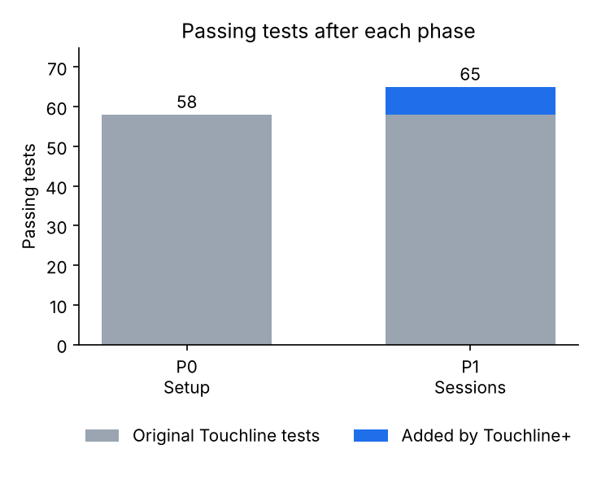

# Touchline+ build summary

_Running summary, updated after every phase._

| Phase | Branch | Tests passing | Report |
| --- | --- | --- | --- |
| 0 — Setup and credit | `phase-0-setup` | 58 | [phase-0](phases/phase-0.md) |
| 1 — Sessions | `phase-1-sessions` | 65 | [phase-1](phases/phase-1.md) |

