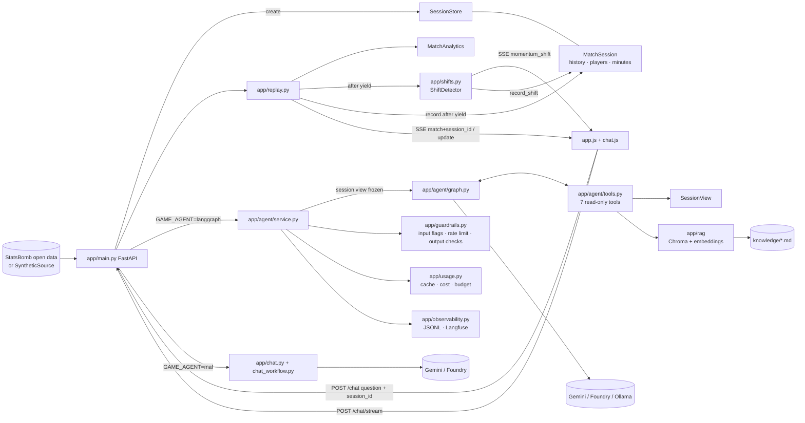
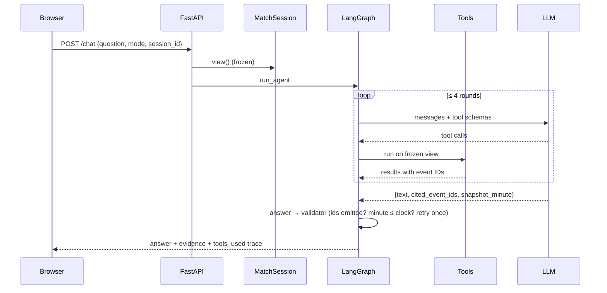
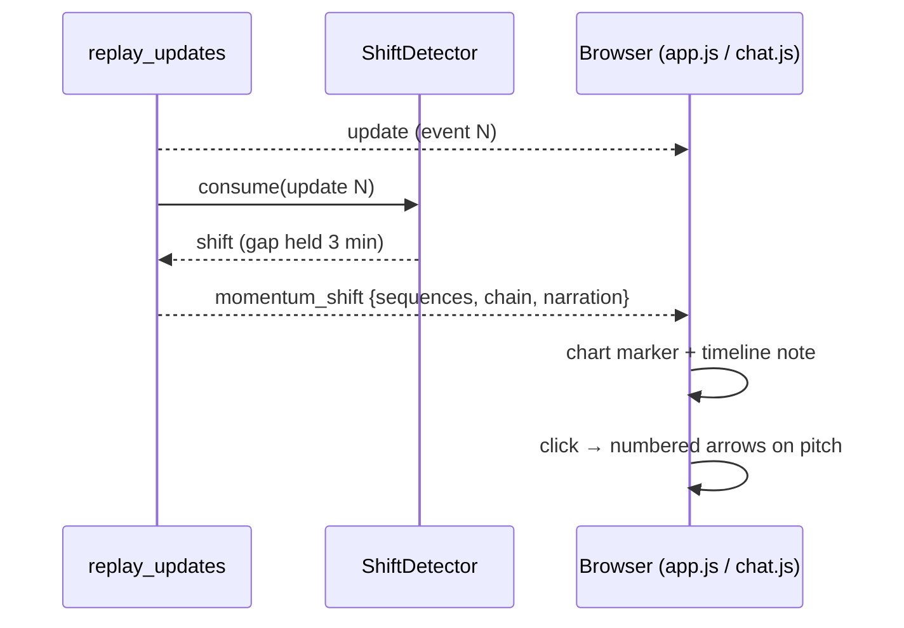
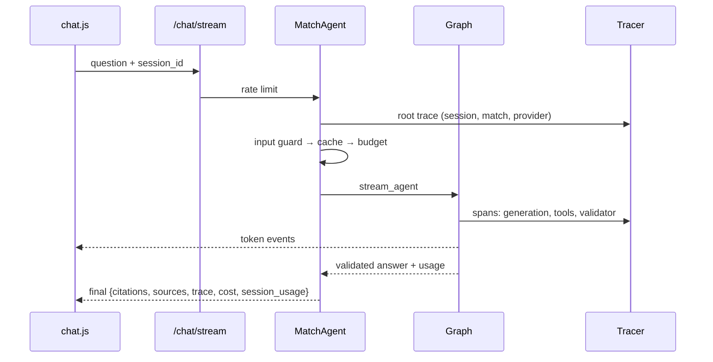
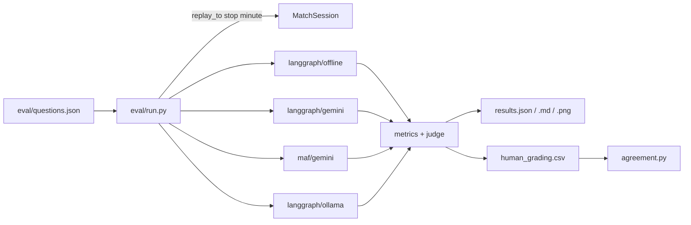
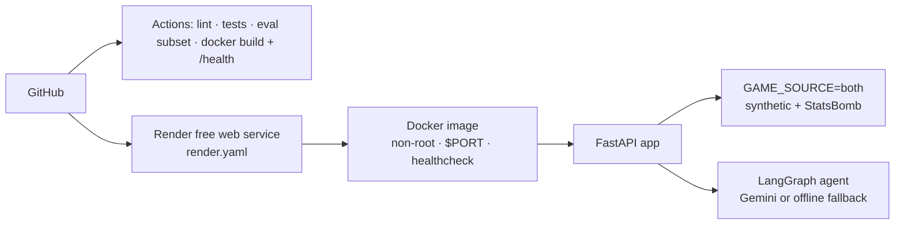

# Touchline+ architecture

_Updated at the end of every phase. Current state: **Phase 6** (deployment)._

## System

## Data flow

## Momentum shift flow (Phase 3)

## Production request flow (Phase 4)

## Evaluation (Phase 5)

## Deployment (Phase 6)

