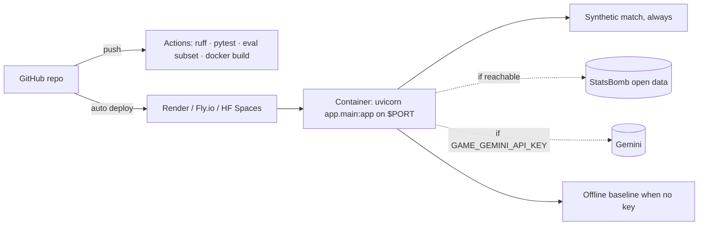

# Deploying Touchline+

The repository ships a production `Dockerfile`, a Render blueprint (`render.yaml`) and CI that builds the image and checks `/health`. The hosted demo is meant to use **Gemini**; **Ollama stays local-only** (a free host cannot run a 7B model). With no key at all the app still works: the synthetic match replays and chat answers with the clearly labelled offline baseline.



## The image
- `python:3.14-slim`, runtime dependencies installed from `Pipfile.lock` with `pipenv install --deploy --system` (no dev tools), app code and `knowledge/` only (`.dockerignore` excludes tests, docs, the demo video, etc.).
- The definitions index is built at image build time with the offline `hash` embedder.
- Runs as a non-root user (`touchline`, uid 10001), listens on `$PORT` (default 8000), with a health check on `/health` that ignores any proxy settings.
- Hosted defaults: `GAME_SOURCE=both`, `GAME_MAX_SESSIONS=50`, `GAME_SESSION_BUDGET_USD=0.05`, traces to `/tmp`.
- Size ≈ 1.1 GB (Chroma, onnxruntime, LangChain). Verified locally: builds, becomes `healthy`, cold start ≈ 2 s, ≈ 125 MiB RAM after a replay.

```bash
docker build -t touchline-plus .
```

```bash
docker run -p 8000:8000 -e GAME_GEMINI_API_KEY=your-key touchline-plus
```

## Option A — Render (recommended, free web service)
1. Push the repository to GitHub.
2. In Render: **New → Blueprint**, pick the repository; Render reads `render.yaml` (Docker runtime, free plan, `/health` check).
3. Set `GAME_GEMINI_API_KEY` in the service's **Environment** (the blueprint marks it `sync: false`). Leave it empty for a key-free demo.
4. Deploy. The public URL is `https://touchline-plus.onrender.com` (or similar). Free services sleep after inactivity; the first request takes ~30–60 s.

## Option B — Fly.io
```bash
fly launch --no-deploy --name touchline-plus --internal-port 8000
```

```bash
fly secrets set GAME_GEMINI_API_KEY=your-key
```

```bash
fly deploy
```

## Option C — Hugging Face Spaces (Docker)
Create a **Docker** Space, push this repository to it, and add this front matter at the top of the Space's README: `sdk: docker` and `app_port: 8000`. Add `GAME_GEMINI_API_KEY` under **Settings → Variables and secrets**. Spaces expose port 7860 by default; `app_port` overrides it.

## Configuration for hosting
| Variable | Hosted value | Why |
| --- | --- | --- |
| `GAME_SOURCE` | `both` | synthetic match always works; StatsBomb catalogue when GitHub is reachable |
| `GAME_CHAT_PROVIDER` | `gemini` | hosted model |
| `GAME_GEMINI_API_KEY` | secret | without it: offline baseline (`GAME_CHAT_FALLBACK_OFFLINE=true`) |
| `GAME_CHAT_RATE_LIMIT` | `6` per minute per session | protects quota |
| `GAME_NOTE_MAX_PER_SESSION` / `GAME_NOTE_MIN_INTERVAL_SECONDS` | `12` / `20` | server-side copy of the UI's timeline-note cooldowns |
| `GAME_SESSION_BUDGET_USD` | `0.05` | caps model spend per replay |
| `GAME_MAX_SESSIONS` | `50` | free-tier memory |
| `GAME_LANGFUSE_*` | optional | tracing ([observability](observability.md)) |

## Ollama (local only)
```bash
ollama pull qwen2.5:7b-instruct
```

```bash
GAME_CHAT_PROVIDER=ollama pipenv run dev
```

## Limitations
- Sessions, cache, usage and rate limits are in memory: run **one instance** (or add sticky sessions / Redis before scaling out).
- The free tiers sleep; SSE replays end when the instance restarts.
- The deployment itself was not performed from the build environment (no hosting account); everything up to a running, healthy container was verified locally.
