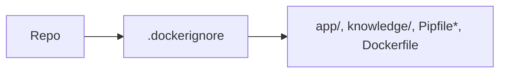

# .dockerignore

## Purpose
Keeps the Docker build context small and secret-free.

## How it works
Excludes git data, virtualenvs, caches, `.env` files, the demo video and `artifacts/`, docs, tools, tests, eval, local data/logs and the future `mobile/` app.

## Connections
`Dockerfile`.

## What changed
New in Phase 6.

## Tests
Image build.

## Limitations and future work
None.
