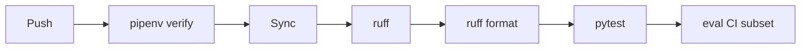

# .github/workflows/checks.yml

## Purpose
CI on every push and pull request: Pipenv lock verification, ruff lint and format check, pytest, and (Touchline+) the evaluation subset.

## How it works
Python 3.14 → `pipenv verify` → `pipenv sync --dev` → `ruff check` → `ruff format --check` → `pytest` → **`python -m eval.run --subset ci --configs langgraph/offline`** with `GAME_RAG_EMBEDDER=hash` (no keys, no model downloads).

## Connections
Uses `Pipfile.lock`, `tests/`, `eval/`.

## What changed
Phase 5: added the eval step.

**Phase 6:** new `docker` job builds the image, runs it and polls `/health` for up to 60 s.

**Phase 7:** new `mobile` job: Node 22, `npm ci`, `npx tsc --noEmit`, `npx jest --ci` in `mobile/`.

## Tests
The workflow is the test runner.

## Limitations and future work
Phase 6 adds the Docker build check.
