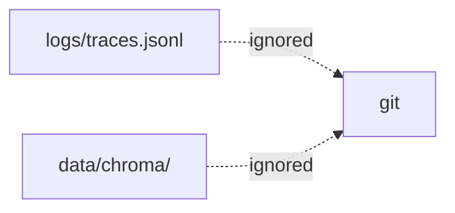

# .gitignore

## Purpose
Keeps local and generated files out of git.

## How it works
Phase 4 adds `/logs/` (JSON-lines traces) and `/data/chroma/` (the local vector index, rebuilt with `python -m app.rag.ingest`).

## Connections
Git only.

## What changed
Two lines appended; Hadi's rules unchanged.

## Tests
None.

## Limitations and future work
None.
