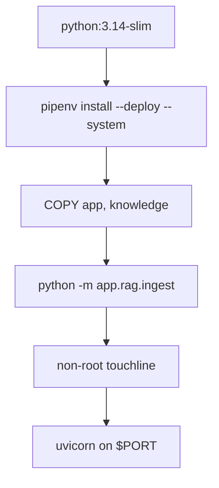

# Dockerfile

## Purpose
The production image for Touchline+, usable on Render, Fly.io or Hugging Face Spaces.

## How it works
1. `python:3.14-slim`; installs `pipenv`, then runtime dependencies from `Pipfile.lock` (`--deploy --system`), then removes pipenv.
2. Copies `app/` and `knowledge/` only.
3. Hosted defaults (`GAME_SOURCE=both`, hash embeddings, small session store, $0.05 budget, `PORT=8000`).
4. `python -m app.rag.ingest` builds the definitions index in the image; creates the non-root `touchline` user and gives it the index folder.
5. `HEALTHCHECK` calls `/health` with proxies disabled; `CMD` runs uvicorn on `$PORT` with proxy headers.

## Connections
`.dockerignore`, `Pipfile.lock`, `render.yaml`, CI `docker` job, [docs/deploy.md](../deploy.md).

## What changed
New in Phase 6.

## Tests
Built and run locally (healthy, no-key chat works); CI builds it and polls `/health`.

## Limitations and future work
~1.1 GB because of Chroma/onnxruntime; a slimmer image could drop RAG dependencies when `GAME_RAG_ENABLED=false`.
