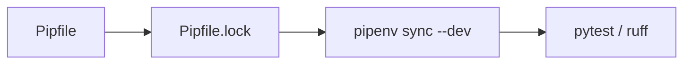

# Pipfile.lock

## Purpose
Exact, hashed versions of every dependency, generated by `pipenv lock` from `Pipfile`. Never edit by hand.

## How it works
`_meta.hash` is the Pipfile's hash (checked by `pipenv verify`); `default` and `develop` hold pinned versions with SHA-256 hashes.

## Connections

## What changed
Regenerated in Phase 0 after adding matplotlib (and its dependencies: contourpy, cycler, fonttools, kiwisolver, numpy, pillow, pyparsing, python-dateutil).

## Tests
`pipenv verify` in CI.

## Limitations and future work
Regenerated whenever a phase adds dependencies.
