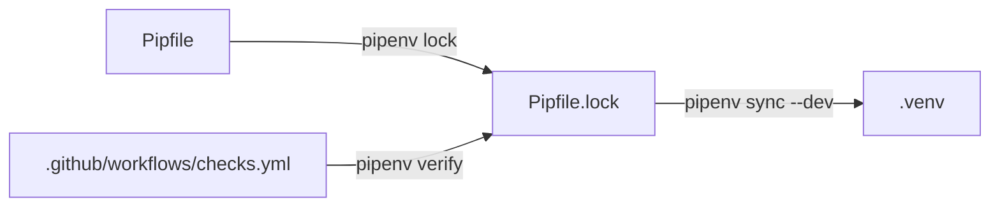

# Pipfile

## Purpose
Declares runtime and development dependencies and the `pipenv run` scripts (`dev`, `test`, `lint`, `format`, …). Pipenv is the only dependency manager.

## How it works
`[packages]` are runtime dependencies; `[dev-packages]` are for tests, linting and documentation tooling. `[requires] python_version = "3.14"`.

## Connections

## What changed
Phase 0: added `matplotlib` to `[dev-packages]` so `tools/charts.py` can render the PNG charts required in docs. Not installed in production images.

## Tests
CI runs `pipenv verify`, which fails if Pipfile and lock disagree.

## Limitations and future work
Unpinned (`*`) versions are pinned in the lock; refresh deliberately with `pipenv lock`.
