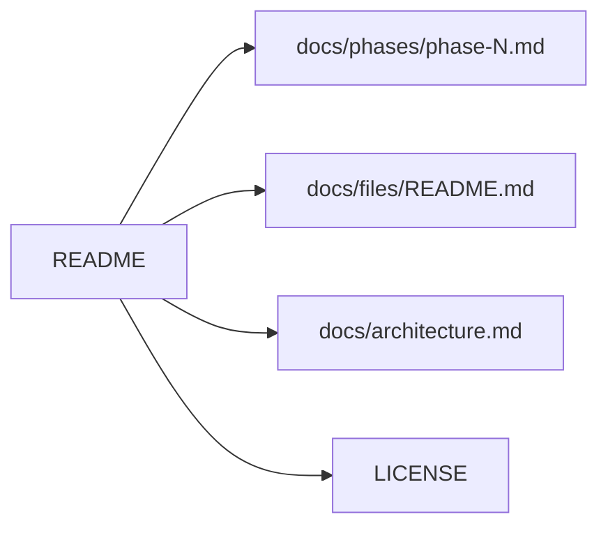

# README.md

## Purpose
The project's front page. In Touchline+ it carries the required credit to Hadi Sotudeh's original Touchline, a phase-by-phase **Changes** list, and (below it) the original documentation.

## How it works
- The very first line is the credit quote required by the build brief.
- `# Touchline+` title, then `## Changes`: one bullet per phase linking its report in `docs/phases/`.
- Everything after "The sections below describe the original Touchline…" is Hadi's text, edited only where a phase changes behaviour it describes.

## Connections

## What changed
Before: title `# Touchline`, no credit note. Phase 0: title renamed, credit note added at the top, Changes list added. LICENSE untouched.

Phase 1: Changes entry added; the paragraph that said the prototype trusts the client snapshot and the `/chat` API row now describe server-side sessions.

## Tests
Documentation only; no tests.

## Limitations and future work
The original sections still mention hackathon hosting (Azure) and the original demo; they are kept as history and labelled as describing the original project.
