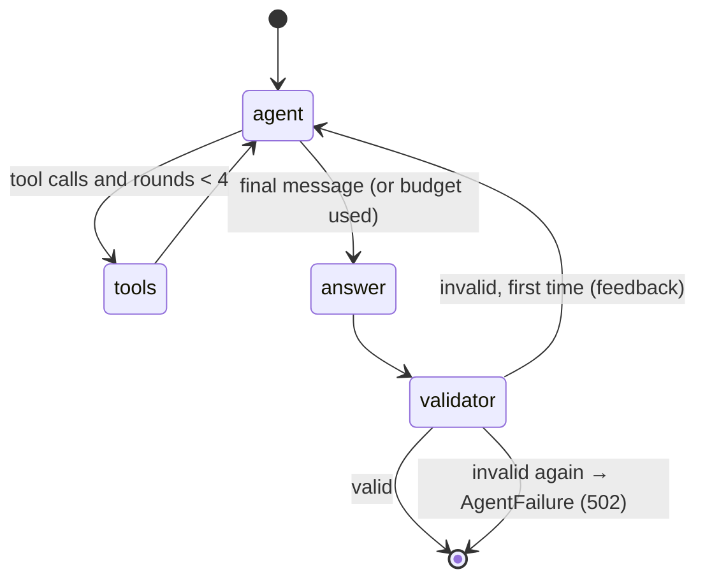
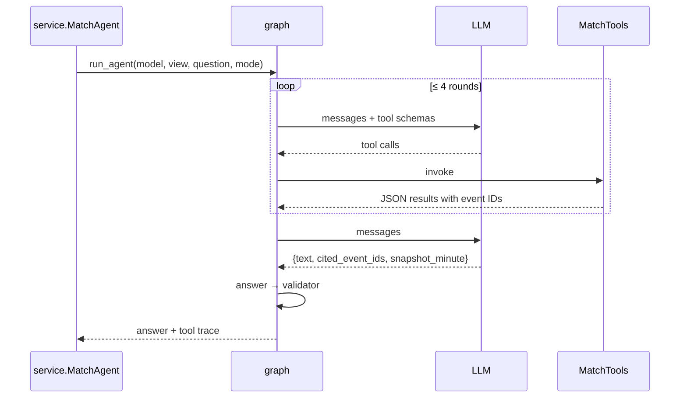

# app/agent/graph.py

## Purpose
The centrepiece of Touchline+: a LangGraph state machine in which the **model chooses its own tools**, then an answer and validator stage enforce grounding before anything reaches the user. It replaces the original fixed "always call three tools, then narrate" workflow (still available with `GAME_AGENT=maf`).

## How it works
- `AgentAnswer` — required structured answer: `text` (≤ 1200 chars), `cited_event_ids` (≤ 6), `snapshot_minute` (≥ 0).
- `AgentState` — `messages` (LangGraph `add_messages` reducer), `tool_trace` (appended `{tool, args}`), `rounds`, `retries`, `draft`, `error`, `answer`, `failure`.
- `SYSTEM_PROMPT` — adapted from the original `app/chat.py` instructions: grounding only in tool results, no external knowledge, untrusted names, uncertainty caveats, short answers, JSON format; plus `AUDIENCE[mode]` for simple vs analyst.
- Nodes in `build_graph(model, view, max_rounds=4)`:
  1. **agent** — `model.bind_tools(...)` invoked on the conversation. After four tool rounds it adds "Tool budget reached. Answer now without tools."
  2. **tools** — runs each requested tool, logs `{tool, args}`, returns `ToolMessage`s (JSON); unknown tools or bad arguments become error results, not crashes. Increments `rounds`.
  3. **answer** — parses the final message (tolerates surrounding text or code fences) into `AgentAnswer`.
  4. **validator** — rejects a malformed answer, any cited id not in `view.event_ids()`, or `snapshot_minute` greater than the session clock. On the first failure it sends the reason back to the agent; on the second it records `failure`.
- `run_agent(...)` seeds the conversation (system prompt + JSON request with question, clock and team names), runs the graph with a recursion limit, and returns `{text, cited_event_ids, snapshot_minute, tools_used}` or raises `AgentFailure`.

Design choices: answers are parsed from JSON text rather than provider-specific structured-output APIs, so the same graph works with Gemini, OpenAI-compatible Foundry, Ollama and the scripted test model; tools are invoked synchronously because they are in-memory and read-only.

## Connections

## What changed
New in Phase 2.

**Phase 4:**
- `AgentContext` (tracer/root span, knowledge base, model label, prices, secrets, input flags).
- Spans: `agent` (generation: tokens, cost, output), one `tool` span per call (args, size, duration), `answer`, `validator` (guardrail).
- `usage` state (reducer sums tokens, cost, model calls).
- `AgentAnswer.cited_sources`; the validator requires sources ⊆ retrieved sources, and at least one when `lookup_definition` was used; it also runs `check_output` (secrets, system prompt, scoreline, future minute).
- Tool results are wrapped with `wrap_data("tool_result", …)`; the question with `wrap_data("question", …)`; flagged questions add `FLAGGED_REMINDER`.
- `stream_agent` uses `graph.astream(stream_mode=["messages","values"])`, extracts the JSON `text` field with `TextFieldStreamer`, emits `reset` when a new agent round starts after text was streamed, then `final`.

## Tests
`tests/test_agent.py`: question-specific tool choices, 4-round limit, fabricated id → retry → 502, validator feedback lets the model correct itself, future `snapshot_minute` rejected.

## Limitations and future work
Small local models may produce poorly formed tool calls; the validator catches bad answers but cannot make a weak model choose good tools. Validated citations prove the event existed, not that the sentence is correct.
