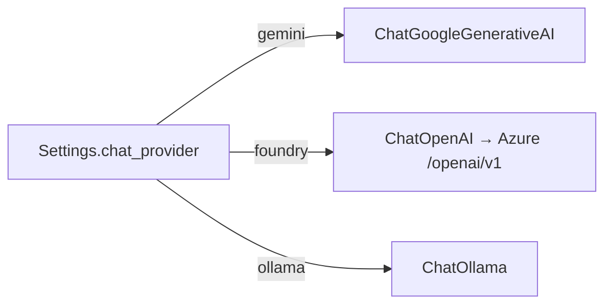

# app/agent/llm.py

## Purpose
One interface for the agent's chat model, selected by `GAME_CHAT_PROVIDER`.

## How it works
- `build_model(settings)`:
  - `gemini` → `ChatGoogleGenerativeAI(model=GAME_GEMINI_MODEL, thinking_level="low")`; raises 503 if no key.
  - `foundry` → `ChatOpenAI` pointed at `{GAME_FOUNDRY_ENDPOINT}/openai/v1` (the same Azure OpenAI v1 endpoint the original code calls) with the deployment as model.
  - `ollama` → `ChatOllama(base_url=GAME_OLLAMA_URL, model=GAME_OLLAMA_MODEL)` (default `qwen2.5:7b-instruct`, chosen for reliable tool calling at 7B).
- `model_name`, `PROVIDER_LABELS` feed the response metadata.
- Provider packages are imported lazily inside each branch.

## Connections
Called by `app/agent/service.py`; reads `app/config.py`.

## What changed
New in Phase 2.

## Tests
`test_providers_build_without_network` builds each provider offline and checks the 503 without a Gemini key.

## Limitations and future work
Not exercised against live providers (no keys in this environment); Ollama tool calling should be smoke-tested locally.
