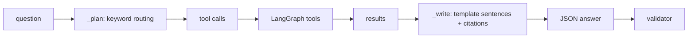

# app/agent/offline.py

## Purpose
`OfflineAnalyst` is a **deterministic, rule-based stand-in for an LLM** (`GAME_CHAT_PROVIDER=offline`). It is not a language model. It exists so that (1) the evaluation harness and CI produce real numbers without any API key, and (2) a public demo can answer questions with no credentials (Phase 6). Every answer still goes through the same LangGraph graph, tools, validator and guardrails as a real model.

## How it works
- `bind_tools(tools)` returns a copy that remembers which tools exist (e.g. `lookup_definition` only when RAG is configured).
- `_plan(question, clock)` routes by keywords: definition questions about a metric → `lookup_definition`; a player-like name (e.g. "Southbank 7") → `get_player_stats`; time windows ("first 15 minutes", "between 10 and 20", "last 10 minutes", "first half") → `compare_periods` or `get_momentum`; momentum words → `get_momentum`; stats words → `get_match_stats` (+ `get_recent_events(type=Shot)` for chance questions).
- `_write(question, clock, results)` turns tool results into 1–3 sentences with the real numbers (score, shots, on target, xG, possession, field tilt, pass completion, player totals, window totals, xT leader, or the first definition section), cites up to 2 recent shot/player event IDs and the retrieved source, and sets `snapshot_minute` to the clock.
- `_generate` — no tool results yet → tool calls; otherwise → the JSON answer.

## Connections
Built by `app/agent/llm.build_model` for provider `offline`; used by `eval/run.py` (`langgraph/offline`).

## What changed
New in Phase 5.

## Tests
`tests/test_eval.py` (CI subset end-to-end, determinism).

## Limitations and future work
It reads the same tool outputs the expected facts are computed from, so its near-perfect eval scores show that the **pipeline** (replay → session → tools → validator) is correct; they say nothing about language understanding. Questions outside its keyword patterns get generic answers.
