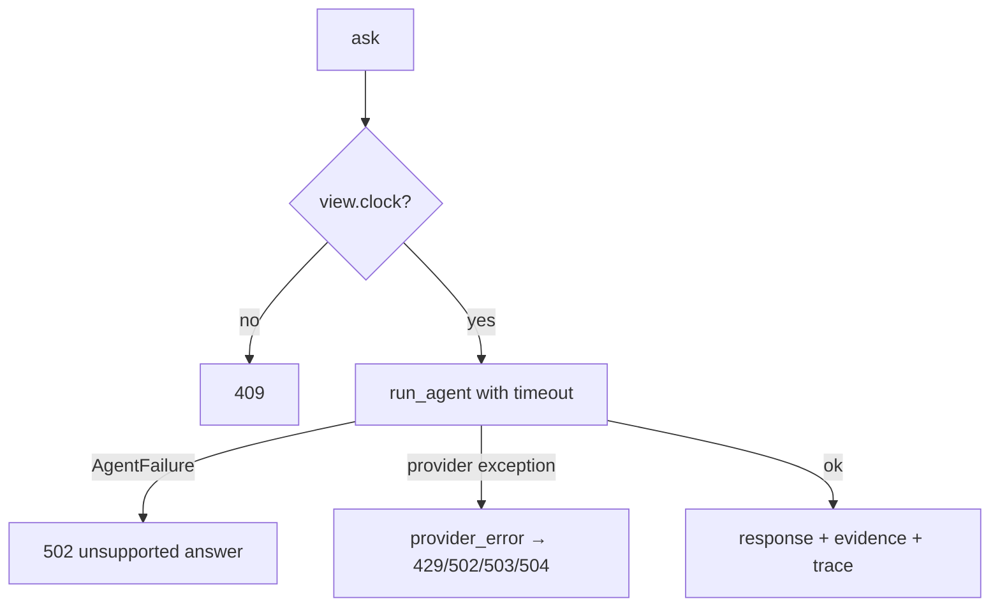
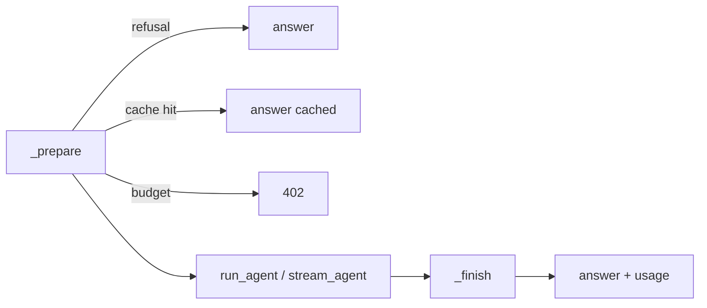

# app/agent/service.py

## Purpose
The API-facing LangGraph chat service: freezes the session, runs the agent with a timeout and maps provider failures to safe HTTP errors.

## How it works
- `MatchAgent(settings, model=None)` — lazily builds the model via `llm.build_model` (tests inject a fake).
- `ask(question, mode, view)` — 409 if the view has no clock; runs `run_agent` under `asyncio.timeout(GAME_CHAT_TIMEOUT_SECONDS)`; returns `text`, `cited_event_ids` (+ `evidence_event_ids` alias for the original UI), `evidence` (event summaries), `snapshot_minute`, `as_of`, `tools_used: [{tool, args}]`, `orchestrator: "LangGraph"`, `provider`, `model`, `mode`.
- `provider_error(error)` walks the exception's cause chain for an HTTP status or a connect/timeout error: 400→502, 401/403→503, 404→503, 429→429, connect→502, timeout→504, other→502. Provider text is logged by type only and never returned.

## Connections
Created in `app/main.py`; uses `graph.py`, `llm.py`, `sessions.SessionView`.

## What changed
New in Phase 2.

**Phase 4:** `MatchAgent(settings, model, tracer, knowledge)`; `ask(question, mode, session)` and `stream(...)` share `_prepare` (root trace, `check_question`, refusals, cache lookup, budget → 402) and `_finish` (evidence, usage into `session.usage`, cache store, root span end). Responses add `cited_sources`, `usage`, `session_usage`, `cached`, `guard_flags`, `refused`.

## Tests
`tests/test_agent.py` (`test_provider_errors_are_sanitized`, `test_chat_endpoint_returns_tool_trace` and the agent tests).

## Limitations and future work
Phase 4 adds tracing, caching, streaming and cost tracking around this service.
