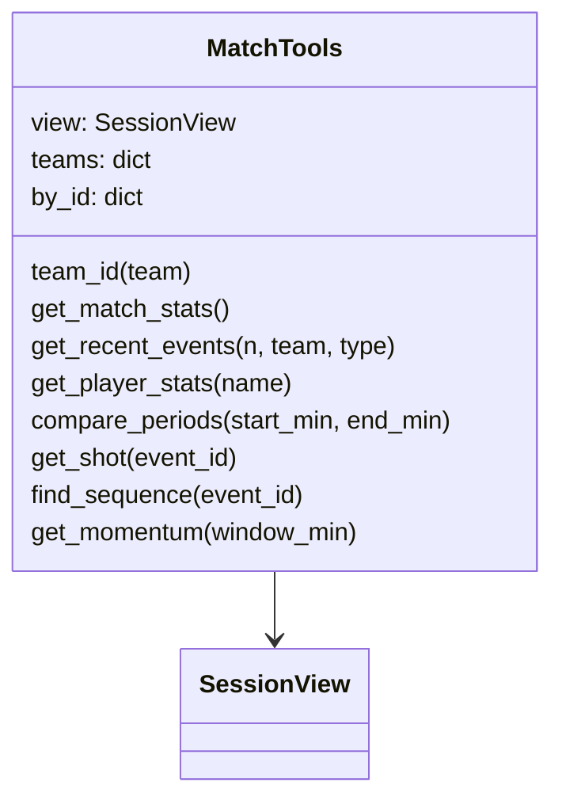

# app/agent/tools.py

## Purpose
The seven read-only tools the LangGraph agent may choose from. They are how the model looks things up instead of receiving one fixed snapshot. Every tool reads a frozen `SessionView`, so **only events already emitted to the viewer** are reachable.

## How it works
`MatchTools(view)` builds a team lookup (`home`/`away`/name/id) and an id → record index over `view.history`.

| Tool | Arguments | Returns | Data source |
| --- | --- | --- | --- |
| `get_match_stats` | — | per team: goals, shots, on target, xG, possession %, field tilt %, pass completion %, passes, corners, tackles; clock | `view.snapshot` (latest analytics) |
| `get_recent_events` | `n` ≤ 30, `team?`, `type?` | newest-first event summaries with IDs | `view.history` |
| `get_player_stats` | `name` | player accumulator (passes, progressive passes, shots, goals, xG, xT added, touches) + 5 recent event IDs; `found: false` if unknown | `view.players` (exact > substring > `difflib` ratio ≥ 0.6) |
| `compare_periods` | `start_min`, `end_min` | team shots/xG/xT/passes inside `[start, end)` vs outside | `view.minutes` via `window_totals` |
| `get_shot` | `event_id` | xG, outcome, body part, shot type, location, freeze-frame | shot record in history |
| `find_sequence` | `event_id` | the possession chain ending at that event (StatsBomb `possession` field), ≤ 25 events | history up to that event |
| `get_momentum` | `window_min` | xT added per team over the last N minutes of the current period, leader, current proxy | `view.minutes`, `view.latest` |

Errors (bad team, bad window) raise `ValueError`; the graph turns them into `{"error": ...}` tool messages so the model can recover. `DESCRIPTIONS` is the model's tool manual, and `langchain_tools()` wraps the methods as LangChain `StructuredTool`s whose argument schemas come from type hints.

## Connections
Used by `app/agent/graph.py`; depends on `app/sessions.py` (`SessionView`) and `app/analytics.py` (`window_totals`).

## What changed
New in Phase 2.

## Tests
`tests/test_agent.py`: tool choice per question, tool errors returned to the model, frozen view, and **`test_no_tool_returns_events_after_the_session_clock`** (runs every tool, including on a future id, and checks every mentioned id was emitted).

## Limitations and future work
`find_sequence` relies on StatsBomb possession ids; xT values come from Karun Singh's public grid, so "xT added" ignores dribbles past players and shots.
