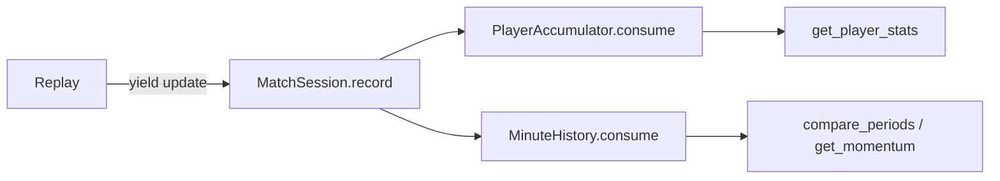

# app/analytics.py

## Purpose
Deterministic, incremental match analytics in StatsBomb's 120 × 80 coordinates: score, shots, xG, possession, field tilt, pass completion, xT momentum and passing networks (Hadi's original), plus Touchline+ per-player and per-minute accumulators.

## How it works
Original: `MatchAnalytics.consume(event)` updates all match-to-date state for one raw event and returns the analytics part of each SSE update.

Phase 2 additions (consume **emitted update payloads**, not raw events):
- `is_progressive(start, end)` — completed pass that ends ≥ 25 % closer to the goal centre (120, 40).
- `PlayerAccumulator` — per player id: `passes, completed_passes, progressive_passes, shots, goals, xg, xt_added, touches` (touches = on-ball event types in `TOUCH_TYPES`). Shoot-out events are ignored.
- `MinuteHistory` — per `(period, minute, team)`: `shots, xg, xt, passes, completed_passes`.
- `window_totals(rows, start, end)` — sums minute rows per team inside `[start, end)` and outside.

Why feed accumulators from emitted payloads? Placing them on `MatchSession` (fed after each yield) makes future leakage structurally impossible and avoids copying player tables into every SSE frame.

## Connections
`MatchAnalytics` is used by `app/replay.py`; the accumulators by `app/sessions.py`; `window_totals` by `app/agent/tools.py`.

## What changed
Phase 2 appended the accumulators; the original `MatchAnalytics` is unchanged.

## Tests
Original analytics tests; `test_player_accumulator_and_progressive_passes` and the agent tool tests.

## Limitations and future work
The progressive-pass rule is a simple distance heuristic, not an official definition.
