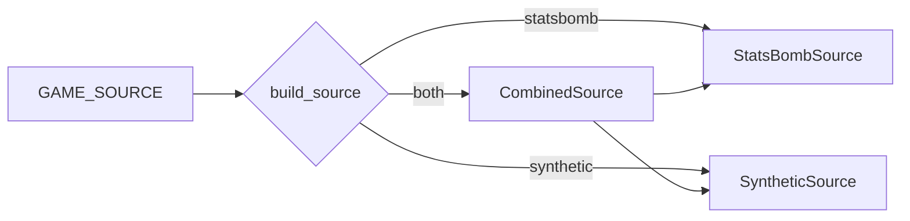

# app/catalog.py

## Purpose
Selects where matches come from (`GAME_SOURCE`): `statsbomb` (original), `synthetic` (offline fictional match), or `both` (synthetic first, StatsBomb appended when reachable) — so a hosted demo always has a match to replay.

## How it works
- `CombinedSource.matches()` — synthetic list, plus StatsBomb's catalogue; network or parsing errors are logged and ignored.
- `CombinedSource.events(match_id)` — synthetic ids go to `SyntheticSource`, others to `StatsBombSource`.
- `build_source(settings)`.

## Connections
`app/main.py`; `app/source.py`, `app/synthetic.py`.

## What changed
New in Phase 6.

## Tests
`tests/test_deploy.py::test_combined_source_survives_statsbomb_outage`, public-demo test.

## Limitations and future work
Synthetic match id 1 must stay distinct from StatsBomb ids (they are 7-digit).
