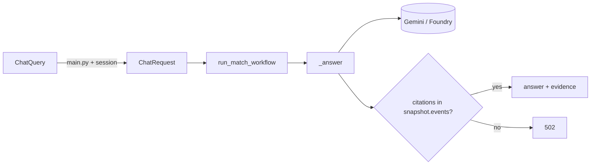

# app/chat.py

## Purpose
Calls the language model (Gemini or Azure Foundry) to answer a match question grounded in a snapshot, with sanitized errors and citation checking. Runs inside the original Microsoft Agent Framework workflow.

## How it works
- `ChatQuery` (Phase 1, public): `question` (1–500 chars), `mode` (`simple`/`analyst`), `session_id` (regex-validated). `extra="ignore"` drops a legacy `snapshot` field instead of trusting it.
- `ChatRequest` (internal): same question/mode plus `snapshot`, bounded to 60 000 JSON chars and 60 events. Now only ever built by the server from `MatchSession.snapshot()`.
- `MatchChat.ask` runs `run_match_workflow`; `_answer` builds the system prompt, calls the provider with retries (`_generate`), validates the JSON answer and rejects citations not in `snapshot.events`.

## Connections
Used by `app/main.py`; depends on `app/chat_workflow.py`, `app/config.py`, `app/sessions.py`.

## What changed
Phase 1: added `ChatQuery`; `ChatRequest` documented as internal-only. Model call logic unchanged.

**Phase 6:** `ChatQuery.purpose` (`ask` | `note`).

## Tests
`tests/test_chat.py`, `tests/test_foundry_chat.py` (original), `tests/test_sessions.py` (ChatQuery handling).

## Limitations and future work
Phase 2 adds a LangGraph agent alongside this fixed workflow.
