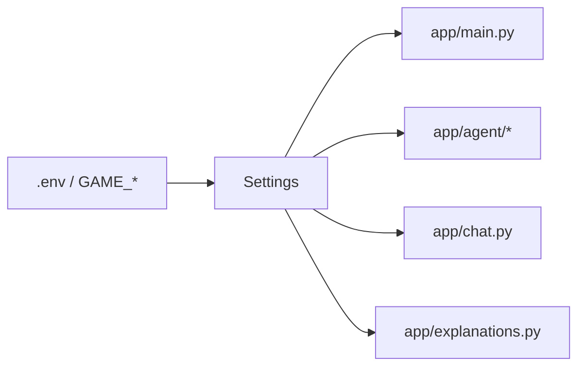

# app/config.py

## Purpose
Environment configuration (`GAME_*` variables, `.env`) validated by pydantic-settings.

## How it works
Phase 2 adds: `agent` (`maf` | `langgraph`, default `langgraph`), `chat_provider` gains `ollama`, `ollama_url` (default `http://127.0.0.1:11434`), `ollama_model` (default `qwen2.5:7b-instruct`), `agent_max_tool_rounds` (1–8, default 4), `chat_timeout_seconds` (default 45). The validator checks the Ollama URL scheme and still requires Foundry credentials when Foundry is selected.

## Connections
Read by almost every module.

## What changed
See above; original fields unchanged.

**Phase 3:** `shift_threshold`, `shift_window_seconds`, `shift_hold_seconds`, `shift_debounce_seconds`.

**Phase 4:** `trace_log`, `langfuse_*`, `rag_*` (enabled, path `data/chroma`, collection, embedder `fastembed|gemini|hash`, model, top_k), `chat_rate_limit`/`chat_rate_window_seconds`, `cache_ttl_seconds`/`cache_max_entries`, `session_budget_usd` (default 0.10), `model_prices`.

**Phase 5:** `chat_provider` accepts `offline`.

**Phase 6:** `source`, `chat_fallback_offline`, `max_sessions`, `session_ttl_seconds`, `note_max_per_session`, `note_min_interval_seconds`.

## Tests
`test_providers_build_without_network`, `test_maf_setting_still_runs_the_original_workflow`.

## Limitations and future work
Phases 4–6 add tracing, cost and source settings.
