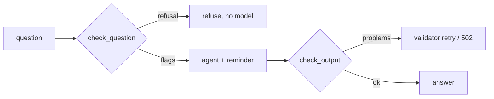

# app/guardrails.py

## Purpose
Defence against prompt injection, spoilers and secret leakage around the agent. See [docs/security.md](../../security.md) for the threat model.

## How it works
- `INJECTION_PATTERNS` — regexes for `override_instructions`, `role_play`, `prompt_extraction`, `secret_request`, `future_request`, `markup_injection`.
- `check_question(question) -> InputCheck(flags, refusal)` — over 500 chars → refusal; secret or system-prompt requests → refusal (no model call); off-topic requests with no football terms → refusal; otherwise flags only (the question still goes to the agent, with a security reminder appended to the system prompt).
- `wrap_data(kind, content, **attrs)` — wraps untrusted text in `<kind …>…</kind>` and strips any matching or `<system>`/`<instructions>` tags inside it, so data cannot close its own block.
- `check_output(text, score, clock_minute, secrets, system_prompt) -> problems` — `secret_leak` (any configured secret value), `system_prompt_leak` (any 8-word passage), `score_mismatch` (a scoreline ≤ 9–9 that isn't the current score either way round), `future_minute` (an explicit minute after the clock).
- `RateLimiter(limit, window_seconds).allow(key)` — sliding window per session.

## Connections
Used by `app/agent/service.py` (input), `app/agent/graph.py` (wrapping, output), `app/main.py` (rate limit).

## What changed
New in Phase 4.

**Phase 5:** the scoreline check only inspects sentences with score context (`SCORE_CONTEXT`: score, lead, win, draw, ends, final, it is, goals…), so "Shots 7-6" or "minutes 0-15" are no longer false positives — found by the eval harness.

## Tests
`tests/test_injection.py` (7 tests).

## Limitations and future work
Pattern-based detection can be evaded; the structural defences (emitted-only tools, citation validation) matter more. An optional model-based classifier is future work.
