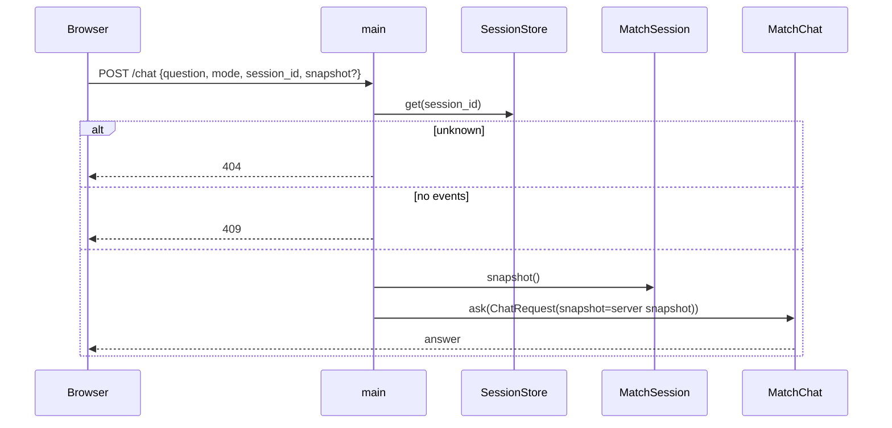

# app/main.py

## Purpose
FastAPI application factory: static pages, match catalogue, the SSE replay stream and `/chat`.

## How it works
- `create_app()` wires `StatsBombSource`, `MatchChat`, `ExplanationProvider` and (Phase 1) `SessionStore` onto `application.state`.
- `GET /matches/{id}/stream` loads the match and events, **creates a session**, and streams `replay(..., session)`.
- `POST /chat` accepts the public `ChatQuery {question, mode, session_id}`: unknown/expired session → 404; no events yet → 409; otherwise it builds the internal `ChatRequest` from `session.snapshot()` and calls the chat.

## Connections
Depends on `app/chat.py`, `app/replay.py`, `app/sessions.py`, `app/source.py`, `app/config.py`, `app/explanations.py`.

## What changed
Before: `/chat` accepted `ChatRequest` with a browser `snapshot`. Phase 1: `ChatQuery` body, session lookup, server-built snapshot; stream endpoint creates a session.

**Phase 2:** `/chat` dispatches on `GAME_AGENT`: `langgraph` → `MatchAgent.ask(question, mode, session.view())`; `maf` → original workflow (Ollama rejected with 503 there), with `tools_used` normalised to `[{tool, args}]`.

**Phase 3:** passes `ShiftSettings` built from settings to `replay`.

**Phase 4:** builds the tracer, knowledge base and per-session `RateLimiter`; `chat_session()` shared by `/chat` and `/chat/stream` (404/409/429); new `POST /chat/stream` (SSE `token`/`reset`/`final`/`error`) and `GET /sessions/{id}/usage`.

**Phase 5:** the original MAF path rejects `offline` (and `ollama`) with 503.

## Tests
`tests/test_app.py`, `tests/test_sessions.py`.

## Limitations and future work
No authentication: the session id is the only credential, which is acceptable for a public replay demo.
