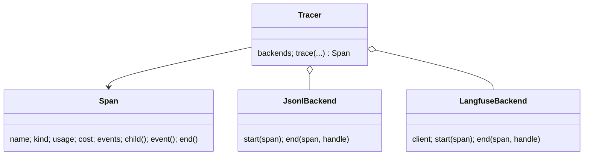

# app/observability.py

## Purpose
Production tracing for the agent: one trace per question or note, with spans for graph nodes, model calls and tool calls, so a bad answer can be debugged after the fact. Every backend is optional; with nothing configured, tracing is a no-op.

## How it works
- `Span(tracer, name, kind, parent, input, metadata)` — records start time, output, metadata, `usage` (tokens), `cost`, `level`, `events`, `duration_ms`. `child()` creates nested spans; `event()` adds point-in-time events (guard flags, cache hits); `end()` is idempotent; usable as a context manager (exceptions mark the span `ERROR`). Each backend's handle is stored per span; backend failures are logged, never raised.
- `Tracer(backends)` — `trace(name, input, session_id, tags, metadata)` starts a root `agent` span.
- `JsonlBackend(path)` — buffers spans per trace and appends **one JSON line per trace** when the root ends (thread-safe append).
- `LangfuseBackend(public, secret, host, client=None)` — maps spans to Langfuse observations (`start_observation(as_type=agent|generation|tool|chain|guardrail)`), propagates `session_id`, tags and trace name with `propagate_attributes`, sends model, `usage_details` and `cost_details` on generations, flushes when the root ends. A client can be injected for tests.
- `build_tracer(settings)` — JSONL if `GAME_TRACE_LOG` is set (default `logs/traces.jsonl`), Langfuse if both keys are set.

## Connections
Built in `app/main.py`; used by `app/agent/service.py` (root spans, events) and `app/agent/graph.py` (node and tool spans). See [docs/observability.md](../../observability.md).

## What changed
New in Phase 4.

## Tests
`tests/test_observability.py`: no-op without keys; every tool and model call produces a span with arguments, size and duration; root carries session id, tags, match, agent; JSONL writes one line per trace; the Langfuse mapping builds the right tree with a fake client (no network).

## Limitations and future work
Not exercised against a live Langfuse server here (no keys). Span inputs include tool arguments and question text; mask them if questions may contain personal data.
