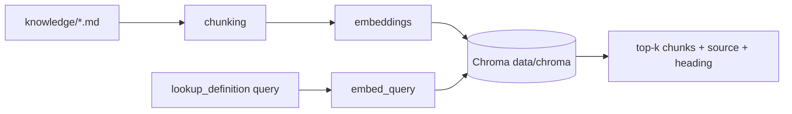
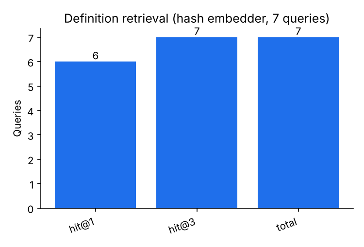

# app/rag/ (package) — `__init__.py`, `chunking.py`, `embeddings.py`, `store.py`, `knowledge.py`, `ingest.py`

## Purpose
Retrieval-augmented generation over football definitions, so the agent explains metrics from documented definitions and cites the source file instead of improvising.

## How it works
- **`chunking.py`** — `chunk_markdown(markdown, source, max_tokens=450, overlap_tokens=60)` splits by `#`/`##`/`###` headings (heading path like `Field tilt › Definition` kept in each chunk), windows long sections by words with overlap; ids are content hashes. `approx_tokens` ≈ 1.3 × words. `load_corpus(folder)` reads `knowledge/*.md` except README.
- **`embeddings.py`** — `Embedder` protocol; `FastEmbedder` (default, local ONNX `BAAI/bge-small-en-v1.5`, downloaded once from Hugging Face), `GeminiEmbedder` (optional), `HashEmbedder` (deterministic hashed bag of words + bigrams; offline, used by tests and CI). `build_embedder(settings)` uses `GAME_RAG_EMBEDDER`.
- **`store.py`** — `ChromaStore(path, collection)`: persistent Chroma with cosine distance, embeddings always supplied (Chroma never downloads its own model), telemetry off. `upsert`, `delete_missing(keep)`, `query(embedding, k)` → `{id, text, source, heading, score}`. The docstring explains how pgvector would replace it (same three methods over a `vector(N)` column with `<=>`).
- **`knowledge.py`** — `KnowledgeBase(store, embedder, top_k).search(query)`; `LazyKnowledgeBase` builds store and embedder on first use (fast, offline start-up) and raises a clear error if the index is empty; `collection_name(settings)` = `{collection}-{embedder}` so vectors of different dimensions never mix; `build_knowledge(settings)` returns `None` when `GAME_RAG_ENABLED=false`.
- **`ingest.py`** — `python -m app.rag.ingest`: chunk, embed, upsert, delete stale chunks; idempotent.

## Connections
`app/agent/tools.py` (`lookup_definition`), `app/main.py` (`build_knowledge`), `app/config.py` (`rag_*`).

## What changed
New in Phase 4.

## Tests
`tests/test_rag.py`: heading chunks and size limits; idempotent ingestion that removes stale chunks; "what is field tilt" retrieves `knowledge/field-tilt.md`; definition questions use the tool and must cite retrieved sources; invented sources are rejected. `tests/test_injection.py` covers a poisoned chunk.

## Limitations and future work
Hugging Face downloads were blocked in the build container, so fastembed could not be run here; the hash embedder scored 6/7 hit@1 and 7/7 hit@3 on the definition queries. Corpus sections are short (≤ ~110 tokens), so each section is one chunk.
