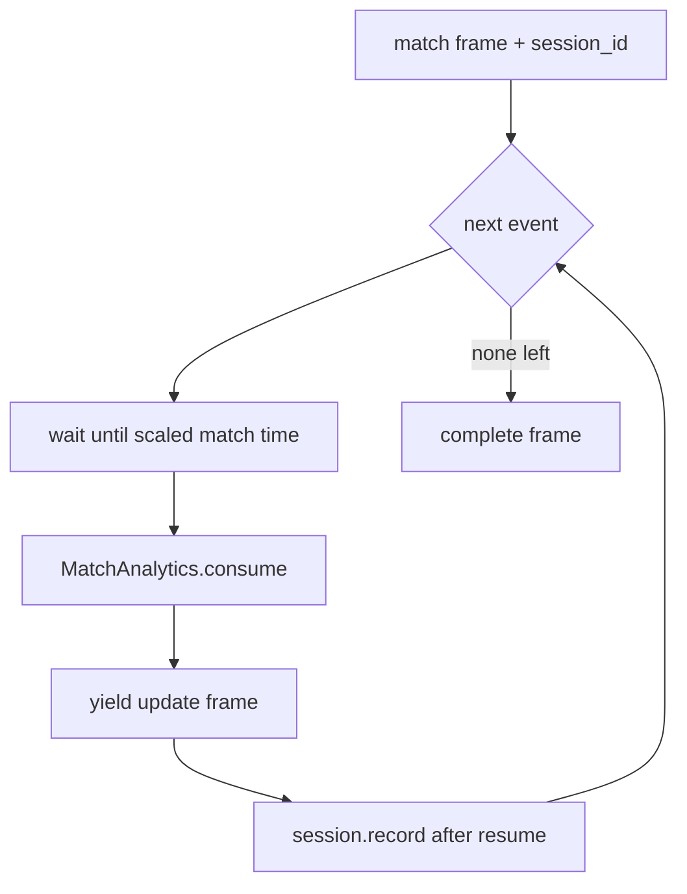

# app/replay.py

## Purpose
Streams a match as Server-Sent Events, one event at a time, paced by match time, with incremental analytics computed as each event is consumed. Optionally interleaves automatic insight frames.

## How it works
- `sse(kind, payload, id)` formats one SSE frame.
- `replay_updates(events, match, speed, disconnected, session=None)`:
  1. yields a `match` frame (now with `session_id` when a session is supplied);
  2. for each event, sleeps until its scaled match time (keep-alive comments while waiting), consumes it with `MatchAnalytics`, builds a sanitized `payload` (no raw fields that could link to future events), yields an `update` frame, and **after the yield resumes** calls `session.record(payload["event"], payload)`;
  3. yields `complete`.
- `replay(..., session=None)` wraps `replay_updates`; when an explanation provider is active it races update frames against pending insight generation. The inner generator only advances after the outer one has yielded the previous frame, so recording still happens after emission.

## Connections
Called by `app/main.py` `/matches/{id}/stream`; depends on `app/analytics.py`, `app/explanations.py`, `app/sessions.py`.

## What changed
Before: no sessions. Phase 1: optional `session` parameter on both generators, `session_id` in the first `match` frame, the update payload is built into a variable so it can be recorded after the yield.

**Phase 3:** a `ShiftDetector` consumes each update after it is yielded; a confirmed shift is yielded as a `momentum_shift` SSE frame and then stored with `session.record_shift`. Optional `shift_settings` parameter on both generators.

## Tests
`tests/test_replay.py` (original behaviour), `tests/test_sessions.py` (session id, recording order, no future leakage).

## Limitations and future work
A frame counts as "emitted" when the ASGI server accepted it, not when the browser rendered it; the difference is at most one in-flight frame.
