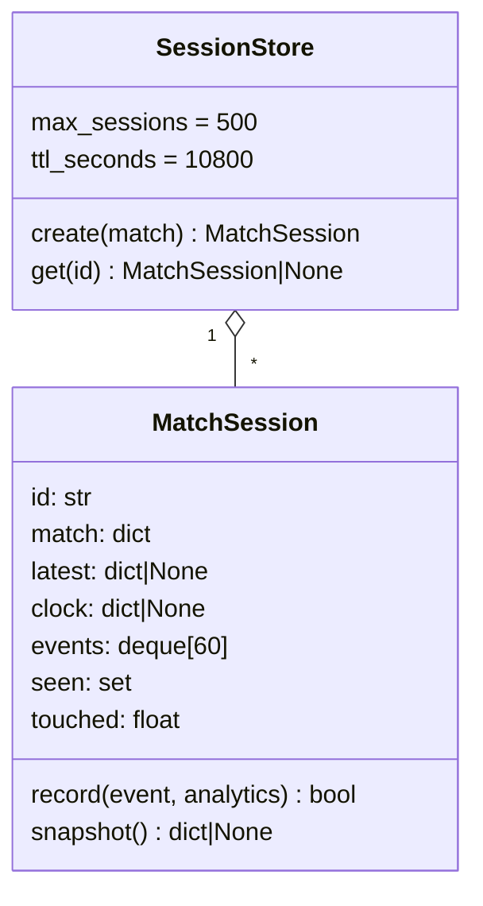
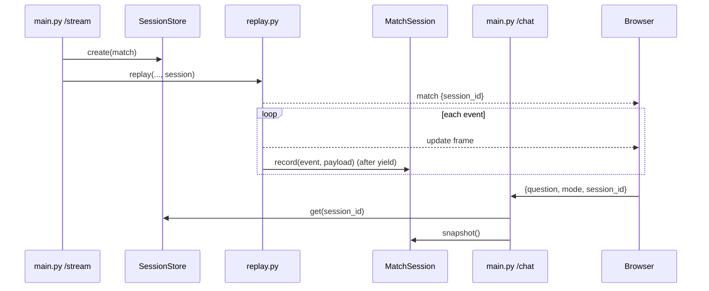

# app/sessions.py

## Purpose
Holds the **authoritative match context** for each replay viewer. In Hadi's original, the browser built the chat snapshot and the server trusted it, so any client could invent scores, future events or prompt-injection text. Touchline+ keeps context on the server: a session only ever contains updates the replay has already emitted.

## How it works
- `RECENT_EVENTS = 60` — size of the newest-first event excerpt sent to the model (same limit the original client used).
- `SESSION_ID_PATTERN` — validation regex for ids in requests (URL-safe, 16–64 chars).
- `summarize(event, analytics) -> dict` — turns an emitted update into the compact event row the chat expects: `id, minute, second, period, team, team_id, action, player`. `action` mirrors the UI timeline (e.g. `Pass · Incomplete`, `Shot · Saved`, `· Yellow Card`).
- `MatchSession` (dataclass)
  - fields: `id` (`secrets.token_urlsafe(16)`, unguessable, so it doubles as a capability), `match`, `latest` (latest full analytics payload), `clock` (`minute/second/period`), `events` (`deque(maxlen=60)`, newest first), `seen` (ids already recorded), `touched` (monotonic time of last use).
  - `record(event, analytics) -> bool` — must be called **after** the update frame is yielded. Ignores duplicate event ids (returns `False`), otherwise prepends the summary, replaces `latest` and `clock`, refreshes `touched`.
  - `snapshot() -> dict | None` — deep copy in the exact shape the original chat used: `match, clock, score, stats, shot_summary, possession, momentum, passing_network, events`. `None` before the first event, so the API can answer 409.
- `SessionStore` — `OrderedDict` used as an LRU. `create(match)`, `get(id)` (refreshes recency and `touched`), TTL 3 h and capacity 500 by default; expired sessions are purged on every access, and the least recently used session is evicted when full.

Design choices: in-memory and per-process (no new infrastructure; replays are per-connection anyway); deep-copied snapshots so later updates can't mutate a request in flight; recording after `yield` gives "already emitted" semantics without parsing SSE text.

## Connections

Used by `app/replay.py` (records), `app/main.py` (store, lookup), `app/chat.py` (`SESSION_ID_PATTERN`).

## What changed
New in Phase 1.

**Phase 2:** `record` also appends a compact per-event record to `history` (event, details, end location, shot, xT, momentum, summary) and feeds `PlayerAccumulator` and `MinuteHistory`. `view()` returns a frozen `SessionView` (history tuple, player and minute snapshots, clock, snapshot) that the agent's tools read, so events emitted while the agent is thinking cannot leak into the answer.

## Tests
`tests/test_sessions.py`: session announced in the stream; chat context equals the last streamed update; client snapshot ignored; 404/409; TTL and LRU eviction; duplicate ids recorded once; and a **no-future-leakage** test that checks, at every yielded frame, the session holds only events already handed out.

## Limitations and future work
- In-memory only: sessions vanish on restart and aren't shared across workers (use sticky sessions or Redis for multi-instance hosting).
- Worst-case memory is bounded by capacity × excerpt; Phase 2 adds fuller history.
