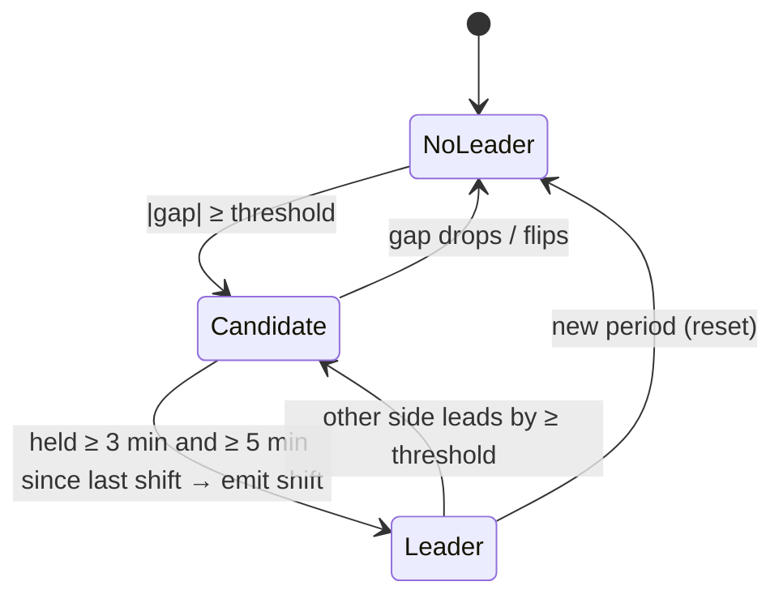
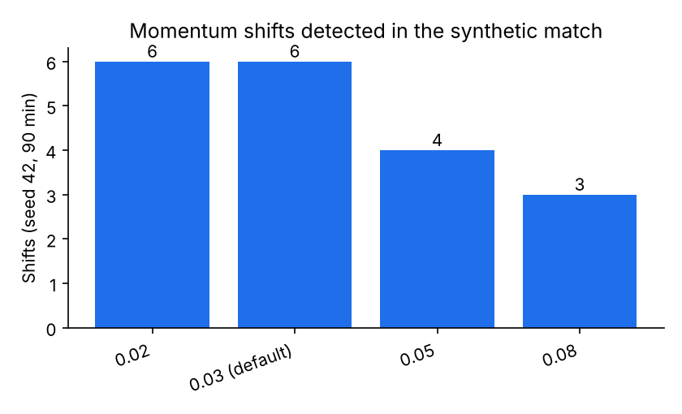
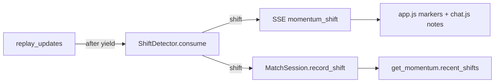

# app/shifts.py

## Purpose
Detects **momentum shifts** — moments when the other team takes over attacking threat — and explains each one with the actual actions behind it, so every automatic note can be traced to events on the pitch.

## How it works
- `ShiftSettings`: `threshold` 0.03 (gap in rolling positive xT added), `window_seconds` 300, `hold_seconds` 180 (≥ 3 match minutes), `debounce_seconds` 300 (shifts ≥ 5 minutes apart), `top_actions` 3, `max_sequence` 8. Configurable via `GAME_SHIFT_*`.
- `ShiftDetector(match, settings)` — `consume(update)` takes one **emitted** update payload:
  1. resets state at each new period (shoot-outs ignored);
  2. buffers a compact record (time, team, type, player, possession, locations, xT);
  3. sums positive xT added per team over the last 5 minutes and computes `gap = home − away`;
  4. if `|gap| ≥ threshold` and the side differs from the current leader, a **candidate** starts; when it has held for `hold_seconds` and the previous shift was ≥ `debounce_seconds` ago, a shift is confirmed;
  5. `_explain` picks the top 3 positive-xT actions by the new leader in the window, groups them by `possession` into sequences (events of that team in the possession up to the top action, ≤ 8), lists players, and writes a template narration, e.g. "Northbridge FC took over from 1′: 3 attacking actions involving Northbridge 3, Northbridge 10 added 0.10 xT, and Northbridge FC lead the last 5 minutes 0.14 to 0.01 in xT added."
- Output (SSE `momentum_shift` payload): `id, minute, second, period, since_minute, trigger_event_id, from_team, to_team, magnitude, window_xt, top_actions, sequences [[event_ids]], chain (positions for drawing), players, narration, cited_event_ids`.

Why xT added instead of the original momentum proxy? The original proxy is capped at 0.1 per team-minute and smoothed; summed xT added over a window ties directly to the actions we cite, which makes the explanation honest.

## Connections

## What changed
New in Phase 3.

## Tests
`tests/test_shifts.py`: synthetic match produces shifts with the documented shape; shifts never reference unemitted events or later minutes; 3-minute hold; 5-minute debounce; per-period reset; shifts reach the session snapshot and the `get_momentum` tool.

## Limitations and future work
Thresholds were tuned on the synthetic match only; real matches may need a different threshold. The narration is a template (deterministic, free, cited); an LLM rewrite could be layered on top.
