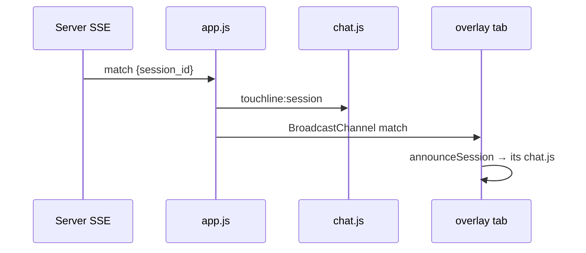
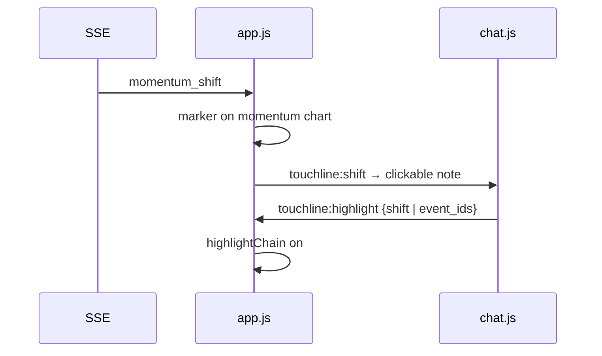

# app/static/app.js

## Purpose
The main browser client: match picker, SSE connection, scoreboard, pitch, shot map, momentum chart, passing networks, event timeline, and the BroadcastChannel link between the matchroom and the overlay.

## How it works (Phase 1 parts)
- `announceSession(data)` dispatches `touchline:session` with `{session_id}` whenever match data carrying a session id arrives.
- Called from the SSE `match` listener, the overlay's BroadcastChannel `match` handler, and `restoreOverlay` (when an overlay joins a running replay), so a following overlay asks questions against the main tab's session.
- `clearState()` still dispatches `touchline:replay-reset`, which `chat.js` uses to forget the session.

## Connections
Loaded by `index.html` and `overlay.html`; talks to `/matches`, `/matches/{id}/stream`; feeds `chat.js` via DOM events.

## What changed
Before: chat context was published as a full snapshot via `touchline:context`. Phase 1: adds `announceSession` and the `touchline:session` event (the `touchline:context` event remains for UI timing checks in chat.js).

**Phase 3:**
- `onShift` stores shifts (with chart position), redraws momentum, dispatches `touchline:shift`, relays to the overlay.
- `eventIndex` keeps positions of every emitted event so cited events can be drawn.
- `drawMomentum` adds clickable arrow markers on the centre line, pointing to the team that took over.
- `highlightChain(groups, label)` draws numbered, animated arrows (`.chain-arrow`, `.chain-step`) for each sequence; `highlightShift`, the `touchline:highlight` listener and `clearHighlight` (Clear highlight button). While a highlight is active, live updates and auto-followed shots do not overwrite the pitch; selecting a shot clears it.
- Overlay snapshot/restore carries shifts and event positions.

## Tests
No JS test runner in this repo; behaviour covered end-to-end by `tests/test_sessions.py` on the server side and `node --check` for syntax.

## Limitations and future work
Plain JS with no build step by design.
