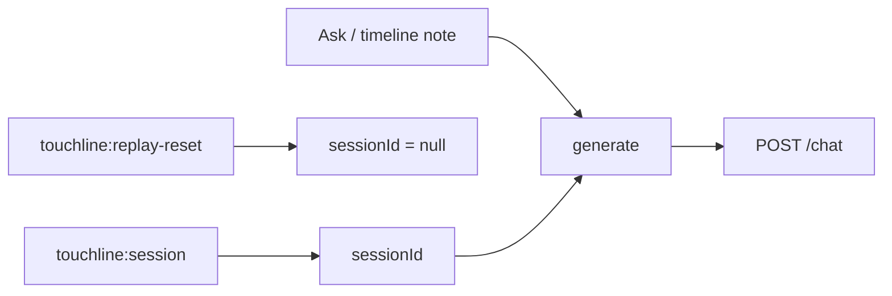

# app/static/chat.js

## Purpose
The Match intelligence panel: automatic AI interpretation notes and "Ask the match".

## How it works (Phase 1 parts)
- Keeps `sessionId`, set by `touchline:session` and cleared by `touchline:replay-reset`.
- `generate()` posts `{question, mode, session_id}` — no snapshot — and shows a clear error if the replay has no session.
- The local `context` copy is still used for UI timing (clock gating for timeline notes and the "as of" stamp).

## Connections
Listens to events from `app.js`; calls `/chat`.

## What changed
Before: sent `snapshot` built from the browser state. Phase 1: sends `session_id` only.

**Phase 2:** `trace(data)` renders `used: tool(args) → tool(args)` under answers and timeline notes; the status line uses `data.orchestrator`.

## Tests
Server-side tests in `tests/test_sessions.py` (client snapshot ignored); syntax via `node --check`.

## Limitations and future work
The "as of" stamp still uses the browser clock at submit time; the server may be one event ahead.
