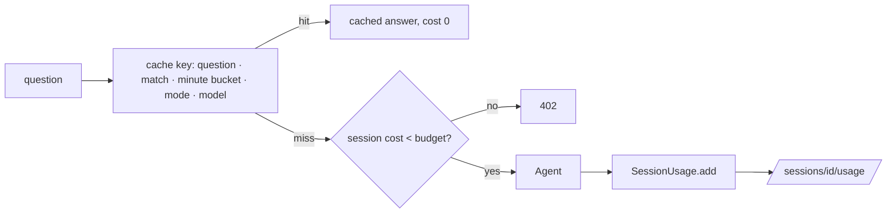

# app/usage.py

## Purpose
Cost control: per-call cost from a price table, per-session usage totals and budget, and the answer cache.

## How it works
- `DEFAULT_PRICES` — USD per 1M tokens `(input, output)`; **placeholders to verify**; override with `GAME_MODEL_PRICES='{"model": [in, out]}'`. Unknown models cost 0 (the generation span records `priced: false`).
- `cost_usd(model, input_tokens, output_tokens, prices)`.
- `SessionUsage` — `questions, model_calls, input_tokens, output_tokens, cost_usd, cache_hits, blocked`; `add(usage)`; `as_dict(budget)` adds `budget_usd` and `budget_remaining_usd`.
- `normalize_question` — lower-case, collapse whitespace, drop punctuation.
- `AnswerCache(max_entries, ttl_seconds)` — LRU + TTL; `key(question, match_id, clock, mode, provider)` buckets the clock by `(period, minute)`.

## Connections
`MatchSession.usage`, `app/agent/service.py`, `app/agent/graph.py`, `app/main.py` (`/sessions/{id}/usage`).

## What changed
New in Phase 4.

## Tests
`tests/test_streaming.py`: cost arithmetic, totals, cache key/TTL, cache hit/miss over HTTP, budget 402.

## Limitations and future work
In-memory: totals and cache reset on restart and aren't shared between workers.
