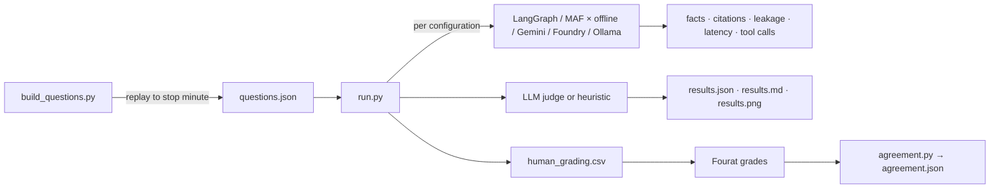

# eval/ — evaluation harness (Phase 5)

Documentation for every file in `eval/`.

## `__init__.py`
Package marker so `python -m eval.run` works.

## `replay.py`
- `replay_to(source, match_id, stop_minute)` — runs the real `replay_updates` on every event before the stop minute at speed 1e12 (no waiting) into a fresh `MatchSession`, so evaluation sees exactly what a viewer would at that minute.
- `source_for(match_id)` — synthetic match 1 offline; other ids from StatsBomb (network).
- `replay_sync` — synchronous wrapper for scripts.

## `build_questions.py`
Generates `questions.json`: for stop minutes 20, 44, 70 and 89 of the synthetic match, it replays and computes expected facts with the same analytics/tools the agent uses — score, shots, xG, possession, field tilt, a top passer, a top shooter, the first-15-minute window and (first half) the 10-minute momentum leader — keeping the first 30, then adds 6 definition questions whose expected fact is the source file. Run `pipenv run python -m eval.build_questions`.

## `questions.json`
36 items: `{id, kind, match_id, stop_minute, question, expected}`. Kinds: score 4, shots 4, chances 4, possession 4, field tilt 3, player passes 3, player shots 3, window 3, momentum 2, definition 6.

## `rubric.md`
1–5 scale over five criteria (grounded, correct, clear, answers the question, admits uncertainty). Shared by the LLM judge and human graders.

## `run.py`
- `discover()` — configurations: `langgraph/offline` always; `langgraph|maf` × `gemini|foundry` when credentials exist; `langgraph/ollama` when `GET {ollama_url}/api/tags` answers. Missing ones are reported as skipped with a reason.
- `ask()` — LangGraph through `MatchAgent` (analyst mode, tracing off); MAF through the original `MatchChat` with the session snapshot.
- Metrics per answer: `fact_present` (numbers with rounding tolerance: ±0.006 for xG, ±0.6 for percentages, exact integers; scorelines; names), citation validity (cited ids emitted), `leaks` (unemitted ids, wrong scorelines, minutes past the stop), latency, tool calls. Definition questions score whether the expected source was cited.
- Judges: `LLMJudge` (rubric prompt → `{score, justification}`; prefers a **different provider** from the one graded), `HeuristicJudge` (labelled stand-in when no model is configured: 1 + 4 × (0.6 facts + 0.2 citations + 0.2 no-leak)).
- Retrieval hit@1/hit@3 for definition questions straight from the knowledge base.
- Outputs `results.json` (summary + every row), `results.md` (table), `results.png` (grouped bars), and `human_grading.csv` (20 answers, only if the file does not exist, so human grades are never overwritten).
- Flags: `--subset ci` (5 questions), `--configs a,b`, `--out DIR`, `--no-human-export`.

## `agreement.py`
Reads the CSV, uses rows with `human_score`; reports exact-match rate, within-1 rate, Cohen's kappa (unweighted) and quadratic-weighted kappa, and lists every disagreement with both justifications; writes `agreement.json`.

## `results.json`, `results.md`, `results.png`, `human_grading.csv`
Generated outputs of the latest full run (offline configuration only in this build).

## Tests
`tests/test_eval.py`: the CI subset end-to-end offline (no leakage, files written, CSV schema), fact matching, leakage detection, kappa against a worked example, agreement report, offline baseline determinism. GitHub Actions also runs the CI subset.

## Limitations and future work
Questions cover the synthetic match only (deterministic and offline); add StatsBomb matches with `match_id` once network access is available in CI. Judge and real-model rows appear only when keys are configured.
