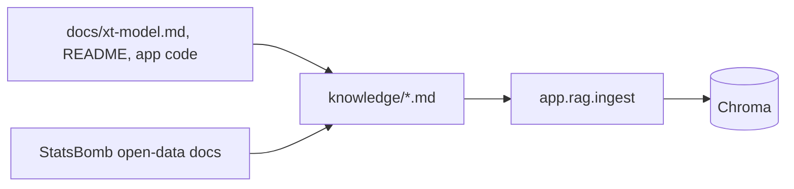

# knowledge/ — the definitions corpus

## Purpose
Short Markdown definitions the agent retrieves with `lookup_definition`: `xg.md`, `xt.md` (incl. the 12×8 grid), `field-tilt.md`, `possession.md`, `momentum.md` (proxy and shifts), `passing-networks.md`, `statsbomb-events.md` (event types and fields). `README.md` explains the folder and is not ingested.

## How it works
Each file starts with **Sources** (Touchline's own docs and code, StatsBomb's open-data documentation, Karun Singh's xT article, socceraction, Opta's momentum explainer) and uses `##` sections (Definition, How Touchline uses it, Limitations) so chunks are self-contained.

## Connections
Read by `app/rag/chunking.load_corpus`.

## What changed
New in Phase 4.

## Tests
`tests/test_rag.py` loads the real corpus.

## Limitations and future work
Written for Touchline's metrics only; extend with new metrics as they are added.
