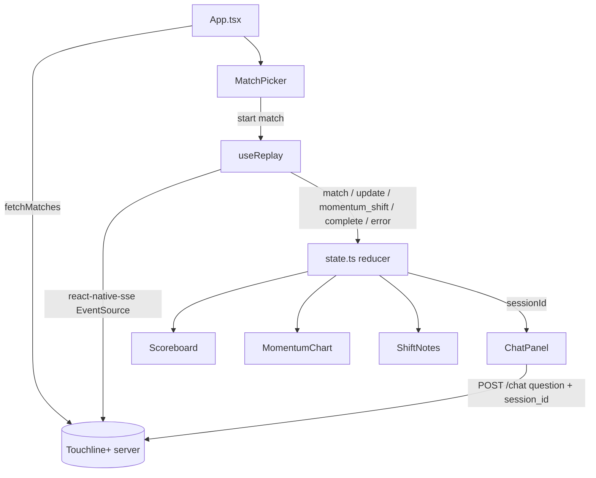
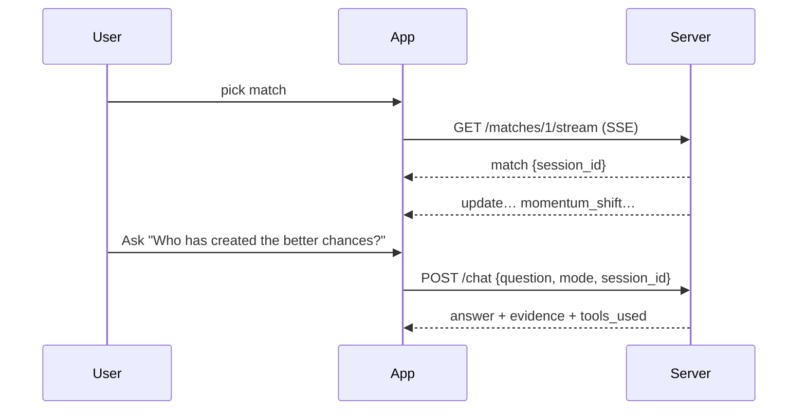

# mobile/ — Expo second-screen app (Phase 7)

Documentation for every file in `mobile/` (stretch phase). Run instructions: [mobile/README.md](../../../mobile/README.md).

## Purpose
A phone companion for the replay: pick a match, follow score, xG and the momentum chart live over SSE, read explained momentum shifts, and ask questions — using the same server, the same `session_id` contract (Phase 1) and the same `momentum_shift` events (Phase 3).

## How it works

### Files
- **`package.json` / `package-lock.json`** — Expo SDK 58 set: `expo ~58.0.22`, `react 19.3.0`, `react-native 0.88.1`, `react-native-svg 15.16.0`, `react-native-sse ^1.2.1`; dev: `jest-expo ~58.0.13`, `jest 30`, `@testing-library/react-native 14` with `test-renderer 1.3` (React 19.3 line), `babel-preset-expo`, TypeScript 5.9. Scripts: `start`, `test`, `typecheck`.
- **`app.json`** — Expo app name/slug. **`index.ts`** — `registerRootComponent(App)`. **`babel.config.js`** — `babel-preset-expo`. **`jest.config.js`** — `jest-expo` preset, tests in `__tests__/*.test.ts(x)`. **`tsconfig.json`** — extends `expo/tsconfig.base.json`, strict, no unused locals/params. **`.gitignore`** — node_modules, `.expo`.
- **`App.tsx`** — loads `/matches` (clear error if the server is unreachable), shows the picker, then the live view; "Stop replay" closes the stream and returns to the picker. `base` prop allows injecting the API URL in tests.
- **`src/config.ts`** — `apiUrl()` from `EXPO_PUBLIC_API_URL` (default `http://localhost:8000`).
- **`src/types.ts`** — `Match`, `Update`, `Momentum`, `MomentumShift`, `ChatAnswer` (subsets of the server payloads).
- **`src/state.ts`** — pure `reducer`: `match` stores `session_id`; `update` sets score, clock, xG and keeps **one momentum point per period-minute** (like the web chart); `momentum_shift` prepends and de-duplicates; `complete`, `error`, `reset`; `formatClock`.
- **`src/api.ts`** — `fetchMatches`, `askQuestion` (**only** `{question, mode, session_id}`), `streamUrl`, `ApiError` with the server's `detail`.
- **`src/useReplay.ts`** — opens `react-native-sse` `EventSource` with automatic reconnects disabled (a reconnect would start a new server session), maps named events to reducer actions, closes on `complete`/`error`/unmount.
- **`src/components/Scoreboard.tsx`** — teams, score, clock, xG, event count or "Full time".
- **`src/components/MomentumChart.tsx`** — `chartGeometry()` (pure: minute → x, net xT proxy clamped to ±0.1 → y, filled area path, shift marker positions) and an SVG with arrow markers pointing to the team that took over.
- **`src/components/ShiftNotes.tsx`** — newest-first shift narrations with minutes and players.
- **`src/components/ChatPanel.tsx`** — suggestions, input, answer, evidence, `traceLine()` (`used: tool(args) → …`), provider/orchestrator; disabled without a session.
- **`src/components/MatchPicker.tsx`** — list of matches. **`src/theme.ts`** — colours shared with the web app.

## Connections
Server endpoints `/matches`, `/matches/{id}/stream`, `/chat` (`app/main.py`); event shapes from `app/replay.py` and `app/shifts.py`.

## What changed
New in Phase 7.

## Tests
`npx jest` — 15 tests in 4 suites; `npx tsc --noEmit` clean. Both run in CI (`mobile` job).
| Suite | Proves |
| --- | --- |
| `state.test.ts` | session id stored; score/clock/xG; one momentum point per minute; updates before `match` ignored; shift de-dup; complete/error/reset |
| `MomentumChart.test.tsx` | geometry (clamping, marker x), area and markers render, empty state |
| `ChatPanel.test.tsx` | request body is exactly `{question, mode, session_id}`; answer, evidence and trace shown; server error detail; disabled without session; trace formatting |
| `App.test.tsx` | full flow with a mocked `EventSource`: pick → match → update → shift → ask uses the streamed session id → complete closes the stream; error + stop returns to the picker; unreachable server message |
`fixtures.ts` holds shared fixtures (not a test file, so importing it registers no tests).

## Limitations and future work
- Not run on a device or simulator here; verified by type-checking, unit/component tests and `expo install --check` (offline table: dependencies match SDK 58).
- The momentum chart uses **react-native-svg** instead of Skia/victory-native (simpler, testable in Jest without native canvas mocks).
- No pitch view or chain highlight yet; answers are not streamed (uses `/chat`).
