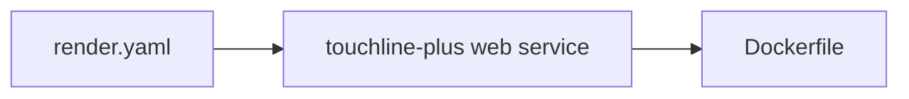

# render.yaml

## Purpose
Render blueprint: one free Docker web service with a `/health` check and hosted settings.

## How it works
Declares `GAME_SOURCE=both`, `GAME_CHAT_PROVIDER=gemini`, `GAME_GEMINI_API_KEY` as a dashboard secret (`sync: false`), budget $0.05, rate limit 6/min, 50 sessions.

## Connections
`Dockerfile`, [docs/deploy.md](../deploy.md).

## What changed
New in Phase 6.

## Tests
Not validated against Render (no account in the build environment).

## Limitations and future work
Free services sleep when idle.
