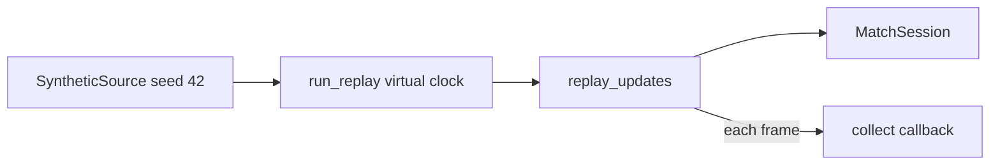

# tests/conftest.py

## Purpose
Shared helpers so tests can replay the synthetic match instantly and deterministically.

## How it works
- `run_replay(events, match, session, collect)` runs the real `replay_updates` with `time.monotonic` and `asyncio.sleep` patched onto a **virtual clock**: pacing logic is exercised exactly, but no real time passes. `collect(frame, session)` is called at each yielded frame — the moment the frame is "emitted" — which is what makes the no-leakage assertion possible.
- `synthetic_session(limit, collect)` replays `SyntheticSource` (seed 42) into a fresh `MatchSession`.

## Connections
Imported by `tests/test_sessions.py` (and later test modules).

## What changed
New in Phase 1.

**Phase 2:** adds `ScriptedModel` (a LangChain `BaseChatModel` that plays back scripted AI turns and records every prompt), `tool_call`, `final` and `tool_results` helpers.

**Phase 4:** autouse fixture disables the trace log and selects the hash embedder; `unwrap()` reads delimited tool results.

## Tests
Exercised by every test that imports it.

## Limitations and future work
Patches module globals, so replays in the same process shouldn't run concurrently with real-clock replays.
