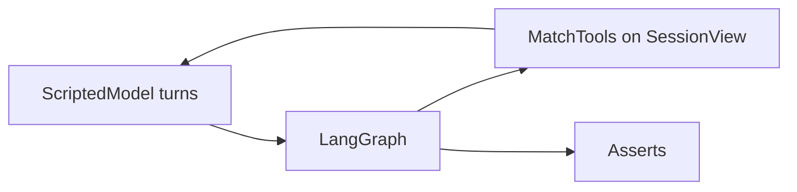

# tests/test_agent.py

## Purpose
Proves the Phase 2 agent's behaviour with a **scripted fake LLM** (`ScriptedModel` in `tests/conftest.py`): no API key, no network.

## How it works
A module fixture replays the synthetic match to ~400 events (first half). `ask()` runs `MatchAgent` with a script of AI turns; callables can read real tool results before answering.

| Test | Proves |
| --- | --- |
| first-half danger question | agent calls `compare_periods` then `get_player_stats`; real data flows back |
| different tools for different questions | shot question → `get_shot` + `find_sequence`; momentum → `get_momentum` |
| tool loop stops after four rounds | exactly 4 executed rounds, budget message sent |
| fabricated id → retry → 502 | validator retries once then errors |
| validator feedback | second attempt with a real id succeeds |
| snapshot_minute after clock | rejected |
| **no tool returns events after the clock** | every tool output only mentions emitted ids |
| frozen view | events appended later are invisible |
| tool errors | bad team / unknown tool go back to the model |
| accumulators | progressive pass, touches, xT added |
| providers | Gemini / Foundry / Ollama build offline |
| provider errors | 429/503/502/504 mapping, nothing leaked |
| `/chat` endpoint | returns `tools_used: [{tool, args}]` |
| `GAME_AGENT=maf` | original MAF workflow still answers |

## Connections
`tests/conftest.py`, `app/agent/*`, `app/main.py`.

## What changed
New in Phase 2.

**Phase 4:** `ask()` passes the session (the service now tracks usage on it); tool results are unwrapped from `<tool_result>` blocks.

**Phase 6:** provider test covers the offline fallback and `chat_fallback_offline=False` → 503.

## Tests
20 tests.

## Limitations and future work
Scripted turns prove orchestration and guards, not a real model's judgement; Phase 5 evaluates real models when keys exist.
