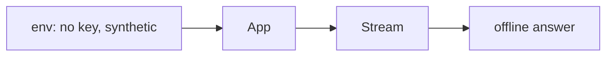

# tests/test_deploy.py

## Purpose
Proves the hosted configuration works without keys or network, and that deployment safeguards hold.

## How it works
| Test | Proves |
| --- | --- |
| `test_public_demo_works_without_a_key` | synthetic source + no key → stream and chat answer via the offline baseline |
| `test_timeline_notes_have_server_side_cooldowns` | note cap per session; questions unaffected |
| `test_note_spacing` | minimum spacing between notes |
| `test_combined_source_survives_statsbomb_outage` | `both` falls back to synthetic |
| `test_offline_fallback_and_session_limits_are_configurable` | fallback rules; `GAME_MAX_SESSIONS`/TTL |

## Connections
`app/catalog.py`, `app/main.py`, `app/agent/llm.py`.

## What changed
New in Phase 6.

## Tests
5 tests.

## Limitations and future work
The container itself is verified manually and in CI's docker job.
