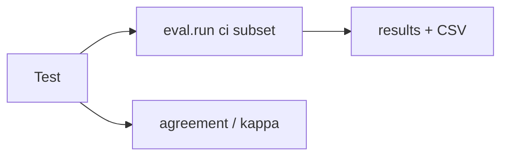

# tests/test_eval.py

## Purpose
Keeps the evaluation harness honest and runnable in CI without keys.

## How it works
| Test | Proves |
| --- | --- |
| `test_ci_subset_runs_offline_with_no_leakage` | `eval.run --subset ci` end-to-end: 5 questions, 0 errors, 0 leakage, other configs skipped, retrieval hit@3 = 1, all output files and the CSV schema |
| `test_fact_matching_tolerates_rounding_but_not_wrong_numbers` | "7-6" parsed as two counts; xG and percentage tolerance; scorelines with en dash |
| `test_leakage_detects_unemitted_citations_and_future_minutes` | leakage metric |
| `test_cohen_kappa_matches_known_values` | kappa = 0.3478 on a worked 2×2 example; weighted > unweighted for near-misses |
| `test_agreement_report_lists_disagreements` | rates, ungraded rows ignored |
| `test_offline_baseline_is_labelled_and_deterministic` | baseline identity |

## Connections
`eval/*`, `app/agent/offline.py`.

## What changed
New in Phase 5.

## Tests
6 tests.

## Limitations and future work
No real-model runs in CI.
