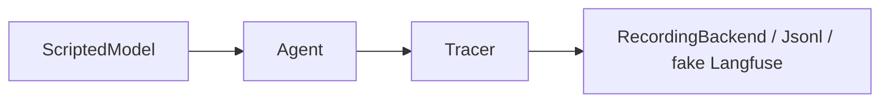

# tests/test_observability.py

## Purpose
Proves tracing is optional and complete.

## How it works
| Test | Proves |
| --- | --- |
| `test_tracing_is_a_noop_without_keys_or_log` | no backends when nothing is configured; answering still works |
| `test_every_tool_call_and_model_call_produces_a_span` | a `tool` span per call (args, size, duration), a `generation` span per model call, validator span; root tagged with session, match, agent, provider |
| `test_jsonl_backend_writes_one_line_per_trace` | local log format |
| `test_langfuse_backend_mirrors_the_span_tree_without_network` | Langfuse observation tree via a fake client |

## Connections
`app/observability.py`, `app/agent/*`.

## What changed
New in Phase 4.

## Tests
4 tests.

## Limitations and future work
No live Langfuse test.
