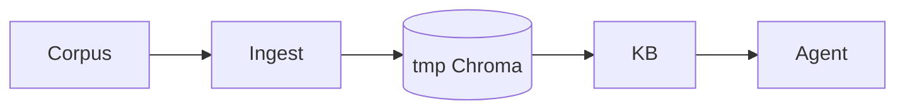

# tests/test_rag.py

## Purpose
Proves the RAG pipeline with a deterministic `HashEmbedder` and a temporary Chroma store (no network).

## How it works
| Test | Proves |
| --- | --- |
| `test_chunks_follow_headings_and_size_limits` | heading paths, ≤ ~450-token windows with overlap, README skipped |
| `test_ingestion_is_idempotent_and_removes_stale_chunks` | re-ingest is a no-op; edited files drop stale chunks |
| `test_field_tilt_query_retrieves_the_field_tilt_definition` | right chunk for "what is field tilt" (and xT) |
| `test_definition_questions_use_lookup_and_cite_sources` | `lookup_definition` is offered and used; answers without sources are sent back to cite them |
| `test_invented_sources_are_rejected` | sources must be ones actually retrieved |

## Connections
`app/rag/*`, `knowledge/`.

## What changed
New in Phase 4.

## Tests
5 tests.

## Limitations and future work
fastembed quality is untested here (Hugging Face blocked).
