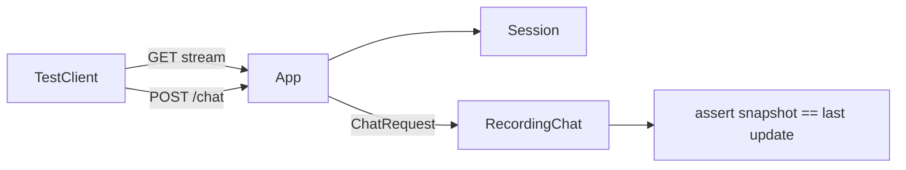

# tests/test_sessions.py

## Purpose
Proves Phase 1's guarantees: the server, not the browser, owns chat context, and that context never runs ahead of the viewer.

## How it works
Uses `create_app()` with `ShortSyntheticSource` (150 synthetic events) and `RecordingChat`, a fake chat that records internal `ChatRequest`s (no model, no network).

| Test | Proves |
| --- | --- |
| `test_stream_announces_a_session_and_chat_matches_last_update` | first SSE event has `session_id`; chat snapshot score/stats/clock/newest id equal the last update; exactly 60 newest-first events |
| `test_each_stream_gets_its_own_session` | sessions are per stream |
| `test_client_supplied_snapshot_is_ignored` | forged `snapshot` never reaches the chat |
| `test_unknown_session_is_404_and_empty_session_is_409` | error contract; malformed id or legacy body → 422 |
| `test_ttl_expiry_and_capacity_eviction` | TTL, LRU eviction, defaults 500 / 3 h |
| `test_duplicate_events_are_recorded_once` | idempotent `record` |
| `test_session_never_holds_events_not_yet_emitted` | **no future leakage** at every frame |

## Connections
Depends on `tests/conftest.py`, `app/main.py`, `app/sessions.py`, `app/synthetic.py`.

## What changed
New in Phase 1.

## Tests
7 tests, all passing.

## Limitations and future work
`TestClient` buffers the whole stream, so mid-stream chat is tested at the generator level instead.
