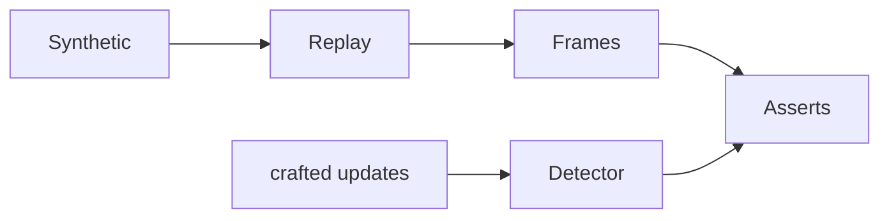

# tests/test_shifts.py

## Purpose
Proves Phase 3's momentum-shift detection is correct and leak-free.

## How it works
`update()` builds minimal emitted payloads; `spell()` feeds a run of one team's actions; `stream()` replays the full synthetic match on the virtual clock and parses frames.

| Test | Proves |
| --- | --- |
| `test_synthetic_match_produces_shifts_with_the_documented_shape` | ≥ 1 shift; all fields present; citations come from its sequences; session stores them |
| `test_shift_never_references_events_after_it` | every referenced id was already emitted, and no chain event is after the shift minute |
| `test_shifts_need_the_gap_to_hold_for_three_minutes` | no shift under 3 minutes of dominance |
| `test_debounce_keeps_shifts_five_minutes_apart` | a quick reversal is held back until 5 minutes pass |
| `test_detector_resets_each_period` | period reset |
| `test_shifts_reach_session_snapshot_and_momentum_tool` | agent can see and cite shifts |

## Connections
`tests/conftest.py`, `app/shifts.py`, `app/agent/tools.py`.

## What changed
New in Phase 3.

## Tests
6 tests.

## Limitations and future work
Frontend drawing is checked manually with Playwright (no JS test runner).
