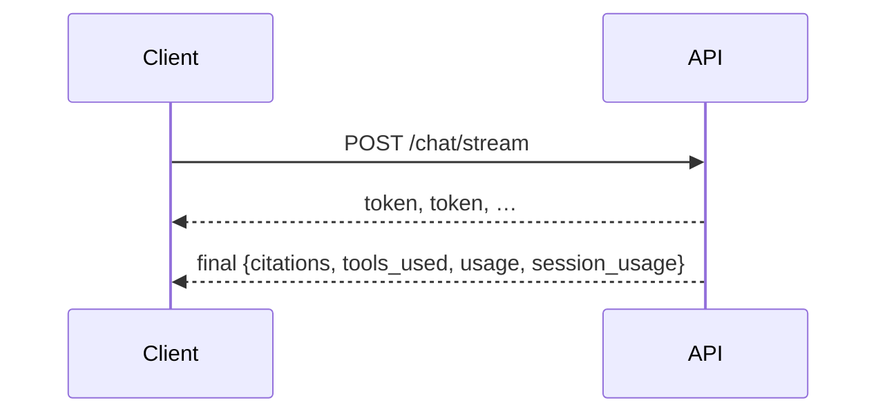

# tests/test_streaming.py

## Purpose
Proves streaming, caching and cost control.

## How it works
| Test | Proves |
| --- | --- |
| `test_stream_sends_tokens_then_final_with_citations_trace_and_cost` | `/chat/stream` order: `token`… then `final` with tool trace, tokens, cost |
| `test_stream_replaces_text_with_error_when_validation_fails` | `token`, `reset`, then `error` 502 |
| `test_cache_hit_and_miss` | normalized repeat is a cache hit (`cached: true`, no model call) |
| `test_budget_blocks_further_model_calls` | 402 after the budget; `/sessions/{id}/usage` totals; unknown session 404 |
| `test_cost_arithmetic_and_usage_totals` | price math and totals |
| `test_cache_keys_and_ttl` | key normalization, minute buckets, TTL |
| `test_text_field_streamer_handles_split_chunks_and_escapes` | incremental JSON `text` extraction |

## Connections
`app/agent/service.py`, `app/agent/graph.py`, `app/usage.py`, `app/main.py`.

## What changed
New in Phase 4.

## Tests
7 tests.

## Limitations and future work
Streaming with real providers is untested without keys (the fake model streams in one chunk in tests; a multi-chunk fake was checked manually in the browser).
