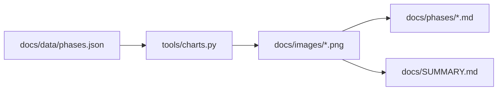
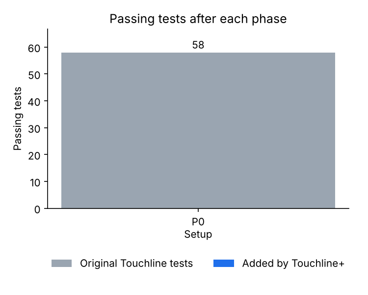

# tools/charts.py

## Purpose
Renders the PNG charts used by phase reports and `docs/SUMMARY.md`, so measurable results (test counts, later latency/cost/eval scores) are visual and reproducible.

## How it works
- `tests_per_phase(phases, baseline, path)` — stacked bars: grey for Hadi's original 58 tests, blue for tests added by Touchline+, total labelled above each bar.
- `bars(title, values, ylabel, path)` — generic labelled bar chart for any `{label: number}` result.
- `main()` — reads `docs/data/phases.json` and writes `docs/images/tests-per-phase.png`, one cumulative `phase-N-tests.png` per phase, plus any extra chart listed under `charts`.
- Uses the `Agg` backend so it runs headless (CI, containers).

Run: `pipenv run python -m tools.charts`.

## Connections

## What changed
New in Phase 0.

## Tests
Not unit-tested (a documentation helper); ruff checks it, and it runs at the end of every phase.

## Limitations and future work
Test counts in `phases.json` are entered from each phase's pytest run, not collected automatically.

