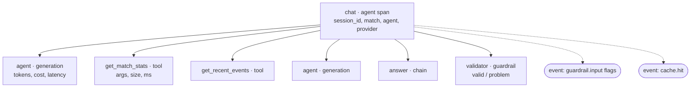

# Observability: traces for every answer

Touchline+ records **one trace per question or timeline note**, tagged with the replay `session_id`, match id, agent mode and provider. Inside it there is a span for every graph node (each model call is a `generation` span with tokens, cost and latency), every tool call (name, arguments, result size, duration) and the validator (a `guardrail` span), plus events for guardrail flags and cache hits.



## Backends (all optional)

| Backend | Enabled when | Where to look |
| --- | --- | --- |
| No-op | nothing configured | — (zero overhead) |
| JSON lines | `GAME_TRACE_LOG` (default `logs/traces.jsonl`; empty disables) | one line per trace: `jq . logs/traces.jsonl` |
| Langfuse | `GAME_LANGFUSE_PUBLIC_KEY` and `GAME_LANGFUSE_SECRET_KEY` set (`GAME_LANGFUSE_HOST` defaults to Langfuse Cloud) | Langfuse UI → Traces, filter by session |

Tracing never breaks answering: backend errors are logged and ignored.

## Self-hosting Langfuse with Docker

```bash
git clone https://github.com/langfuse/langfuse.git
```

```bash
cd langfuse && docker compose up -d
```

Open http://localhost:3000, create an organisation and project, then copy the project's API keys into `.env`:

```bash
GAME_LANGFUSE_HOST=http://localhost:3000
GAME_LANGFUSE_PUBLIC_KEY=pk-lf-...
GAME_LANGFUSE_SECRET_KEY=sk-lf-...
```

Restart `pipenv run dev`. Every question now appears as a trace named `chat` (or `chat.stream`), grouped by session.

> Screenshot placeholder: `docs/images/langfuse-trace.png` — a Langfuse trace tree for one question (add after the first real run).
>
> Screenshot placeholder: `docs/images/langfuse-sessions.png` — the session view listing a replay's questions.

## Walkthrough: debugging a bad answer

1. **Find the trace.** The UI shows the replay clock; the API response carries `session_usage`. Filter traces by `session_id` (Langfuse) or `jq 'select(.session_id=="…")' logs/traces.jsonl`.
2. **Did the question trip a guard?** Look for the `guardrail.input` event (`override_instructions`, `future_request`, …). Flagged questions get a security reminder appended to the system prompt.
3. **Which tools ran, with which arguments?** Tool spans show `get_player_stats {"name": "Cazorla"}` and the result size; a tiny size or an `error` field explains a vague answer (e.g. a misspelled player not found).
4. **What did the model say each round?** `generation` spans hold the tool calls or the raw answer text, tokens and cost.
5. **Why was it rejected?** The `validator` span records `problem` (e.g. "Cited event IDs not emitted…", `score_mismatch`, `future_minute`, `secret_leak`) and whether a retry followed. A `guardrail.output` event on the root means both attempts failed and the user saw the sanitized 502.
6. **Was it cached?** A `cache.hit` event means no model call was made; clear by waiting for the TTL or changing the question.

## Cost and latency

Each `generation` span carries token counts and a cost computed from the price table (`app/usage.py`, override with `GAME_MODEL_PRICES`). Per-session totals are at `GET /sessions/{id}/usage` and in the UI status line.
