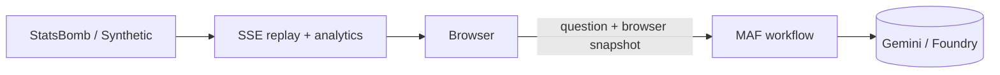
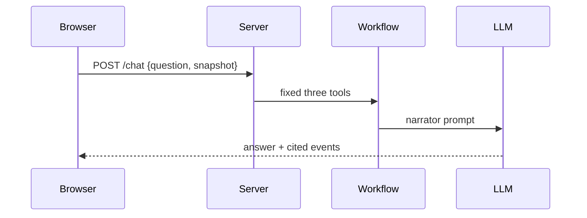
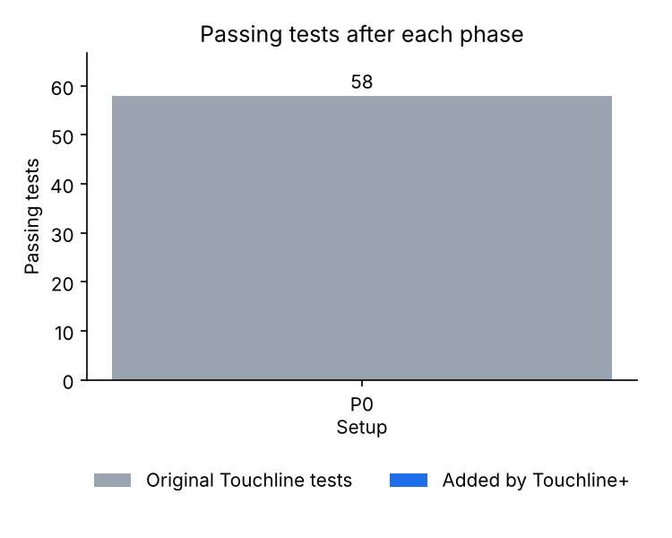

# Phase 0 — Fork setup and credit

Branch: `phase-0-setup` (from `main`).

## What was built
- Ran `PIPENV_VENV_IN_PROJECT=1 pipenv sync --dev` on Python 3.14.6 and recorded the baseline: **58 passed**, ruff clean, `pipenv verify` OK.
- README renamed to **Touchline+**, with the credit note at the very top and a **Changes** list.
- Documentation scaffolding: `docs/architecture.md`, `docs/files/` index, `docs/phases/`, `docs/SUMMARY.md`.
- `tools/charts.py` and `docs/data/phases.json` to render charts; `matplotlib` added as a dev dependency.

## Files touched
| File | Doc |
| --- | --- |
| `README.md` | [doc](../files/README.md.md) |
| `Pipfile`, `Pipfile.lock` | [doc](../files/Pipfile.md), [lock](../files/Pipfile.lock.md) |
| `tools/charts.py` (new) | [doc](../files/tools/charts.py.md) |

## Architecture after this phase
Unchanged from Hadi's original; see [architecture.md](../architecture.md).

## Main request flow (unchanged)

## Test results
58 passed, 0 skipped.

## Decisions to review
- The container's system Python is 3.13; the project targets 3.14, so Python 3.14.6 was installed with `uv` and used for Pipenv.
- `matplotlib` is a dev dependency (documentation charts only).

## Open issues
None.
