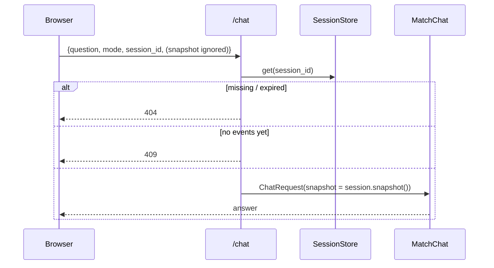
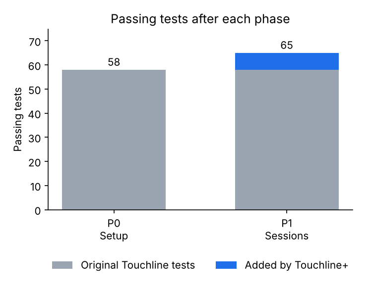

# Phase 1 — Server-side match sessions

Branch: `phase-1-sessions` (from `phase-0-setup`).

## What was built
- `app/sessions.py`: `MatchSession` (id, match, latest, clock, 60-event newest-first deque, duplicate-safe `record`, `snapshot()`), `SessionStore` (3 h TTL, capacity 500, LRU eviction, `secrets.token_urlsafe(16)` ids).
- `app/replay.py`: optional session; first `match` frame carries `session_id`; each update is recorded **after** its frame is yielded.
- `app/main.py`: `SessionStore` on app state; stream endpoint creates a session; `/chat` takes `ChatQuery {question, mode, session_id}` → 404 unknown/expired, 409 no events, otherwise builds the internal `ChatRequest` from `session.snapshot()`.
- Frontend: `app.js` dispatches `touchline:session` (SSE match event, overlay BroadcastChannel, overlay restore); `chat.js` stores it, clears it on reset and sends `session_id` instead of a snapshot.
- README Changes entry, and the line that said the prototype trusts the client snapshot is replaced.

## Files touched
| File | Doc |
| --- | --- |
| `app/sessions.py` (new) | [doc](../files/app/sessions.py.md) |
| `app/replay.py` | [doc](../files/app/replay.py.md) |
| `app/main.py` | [doc](../files/app/main.py.md) |
| `app/chat.py` | [doc](../files/app/chat.py.md) |
| `app/static/app.js` | [doc](../files/app/static/app.js.md) |
| `app/static/chat.js` | [doc](../files/app/static/chat.js.md) |
| `tests/conftest.py` (new) | [doc](../files/tests/conftest.py.md) |
| `tests/test_sessions.py` (new) | [doc](../files/tests/test_sessions.py.md) |
| `README.md` | [doc](../files/README.md.md) |

## Architecture after this phase
```mermaid
flowchart LR
    Replay -->|record after yield| Session[MatchSession]
    Browser -->|question + session_id| Main[/chat]
    Main -->|snapshot| Chat[MAF workflow] --> LLM[(LLM)]
    Session --> Main
```
Full diagrams: [architecture.md](../architecture.md).

## Main request flow changed


## Test results
**65 passed** (58 original + 7 new), 0 skipped; ruff check and format clean.



## Decisions to review
- **Push blocked:** GitHub returned 403 for every push (Claude has no access to `fouratrachid/Inside-the-Game-Hackathon`). Branches are committed locally in the session container; see `docs/SUMMARY.md`.
- The overlay that follows a matchroom tab uses the matchroom's session (relayed via BroadcastChannel) rather than opening its own stream.
- `record(event, analytics)` receives the sanitized emitted event and the full update payload (needed for shot outcomes and card details in the summary).

## Open issues
- Sessions are per process; multi-worker hosting needs sticky routing or a shared store.
