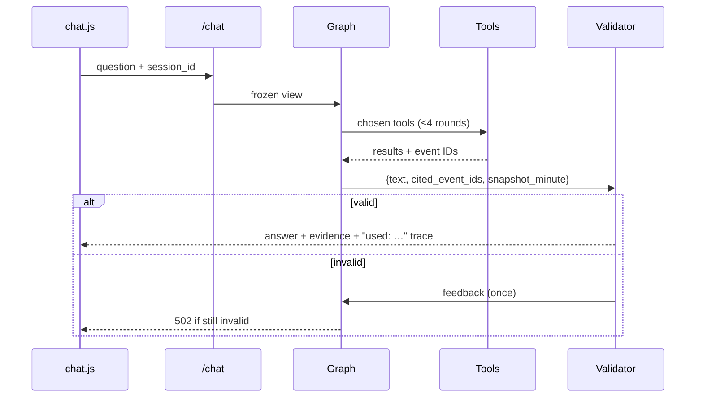
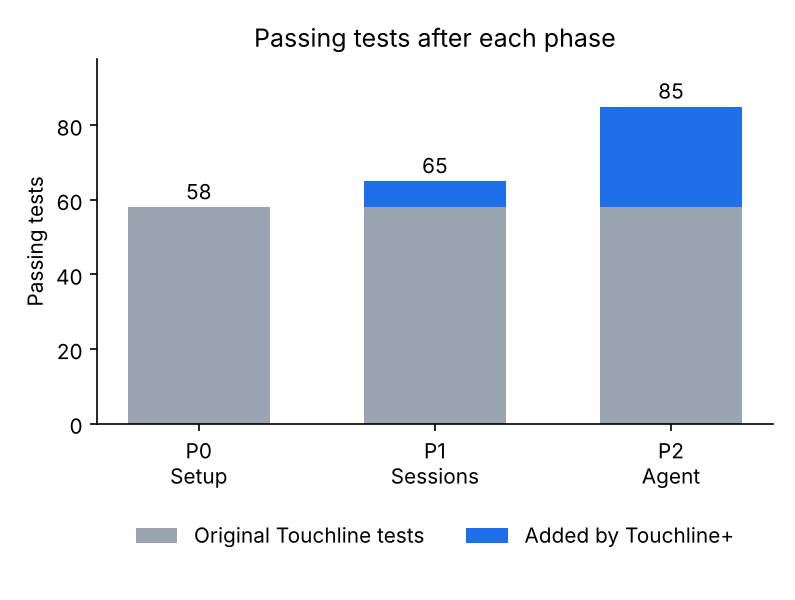

# Phase 2 — LangGraph agent that chooses its own tools

Branch: `phase-2-agent` (from `phase-1-sessions`).

## What was built
- **Analytics** (`app/analytics.py`): `PlayerAccumulator` (passes, completed, progressive, shots, goals, xG, xT added, touches), `MinuteHistory` (per-minute team shots/xG/xT/passes), `window_totals`.
- **Sessions** (`app/sessions.py`): full compact emitted history, accumulators fed after each yield, frozen `SessionView` via `view()`.
- **Tools** (`app/agent/tools.py`): `get_match_stats`, `get_recent_events(n≤30, team?, type?)`, `get_player_stats(name)`, `compare_periods(start_min, end_min)`, `get_shot(event_id)`, `find_sequence(event_id)`, `get_momentum(window_min)`.
- **Graph** (`app/agent/graph.py`): agent ⇄ tools (max 4 rounds, `{tool, args}` logged) → answer (`{text, cited_event_ids, snapshot_minute}`) → validator (schema, emitted ids, minute ≤ clock; one retry, then sanitized 502).
- **Providers** (`app/agent/llm.py`): Gemini, Azure Foundry (OpenAI v1 endpoint), Ollama (`GAME_OLLAMA_URL`, default model `qwen2.5:7b-instruct`).
- **API/UI**: `GAME_AGENT=maf|langgraph` (default `langgraph`); `/chat` returns `tools_used: [{tool, args}]` for both pipelines; answers and timeline notes show `used: tool(args) → …`.
- Pipfile: `langgraph`, `langchain-core`, `langchain-google-genai`, `langchain-ollama`, `langchain-openai`.

## Files touched
| File | Doc |
| --- | --- |
| `app/agent/__init__.py`, `tools.py`, `graph.py`, `llm.py`, `service.py` (new) | [init](../files/app/agent/__init__.py.md), [tools](../files/app/agent/tools.py.md), [graph](../files/app/agent/graph.py.md), [llm](../files/app/agent/llm.py.md), [service](../files/app/agent/service.py.md) |
| `app/analytics.py` | [doc](../files/app/analytics.py.md) |
| `app/sessions.py` | [doc](../files/app/sessions.py.md) |
| `app/config.py` | [doc](../files/app/config.py.md) |
| `app/main.py` | [doc](../files/app/main.py.md) |
| `app/static/chat.js`, `app/static/style.css` | [chat.js](../files/app/static/chat.js.md), [style.css](../files/app/static/style.css.md) |
| `tests/conftest.py`, `tests/test_agent.py` (new), `tests/test_sessions.py` | [conftest](../files/tests/conftest.py.md), [test_agent](../files/tests/test_agent.py.md), [test_sessions](../files/tests/test_sessions.py.md) |
| `Pipfile`, `Pipfile.lock`, `.env.example`, `README.md` | [Pipfile](../files/Pipfile.md), [.env.example](../files/.env.example.md), [README](../files/README.md.md) |

## Architecture after this phase
```mermaid
flowchart LR
    Browser -->|question + session_id| API[/chat]
    API -->|langgraph| Graph[agent ⇄ tools → answer → validator]
    Graph --> View[frozen SessionView]
    Graph --> LLM[(Gemini / Foundry / Ollama)]
    API -->|maf| MAF[original workflow]
```
Full diagrams: [architecture.md](../architecture.md).

## Main request flow changed


## Test results
**85 passed** (65 + 20 new in `tests/test_agent.py`), 0 skipped; ruff clean.



## Decisions to review
- **No API key**: every LLM path is tested with `ScriptedModel`; Gemini/Foundry/Ollama are constructed but never called. Please smoke-test with a real key and a local Ollama (`ollama pull qwen2.5:7b-instruct`).
- Structured output is parsed from JSON text instead of each provider's structured-output API so one graph works for every provider and the fake model.
- After 4 tool rounds the agent is asked once more to answer without tools (rather than failing immediately).
- `GAME_AGENT=maf` with `GAME_CHAT_PROVIDER=ollama` returns 503 (the original workflow never supported Ollama).
- Per-player and per-minute accumulators are fed by `MatchSession.record` from emitted payloads, not inside `MatchAnalytics.consume`, so they can never see unemitted events and are not copied into every SSE frame.
- Progressive pass = completed pass ending ≥ 25 % closer to goal (heuristic).
- Push still blocked (403).

## Open issues
- Real-model tool-choice quality is unmeasured until Phase 5 runs with keys.
- Session memory grows with full history (~1–2 KB per event); with 500 sessions of full StatsBomb matches, memory could reach a few GB. Lower `max_sessions` for small hosts.
