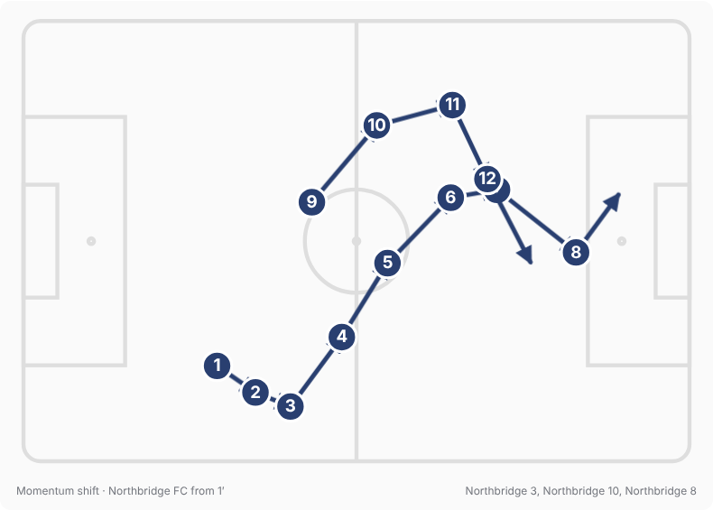
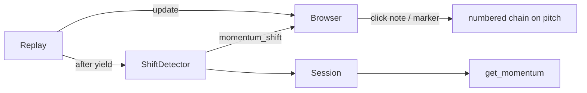
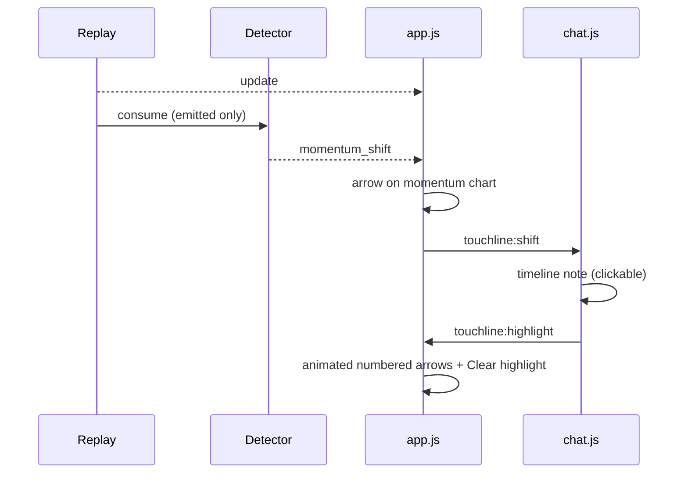
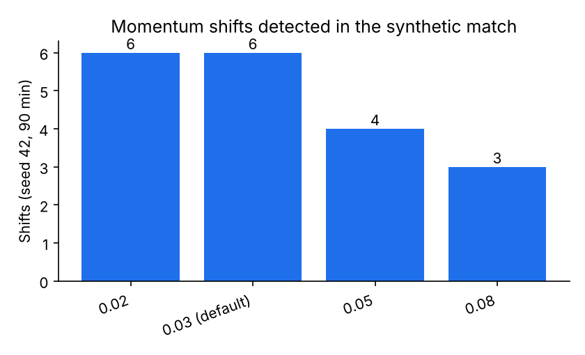
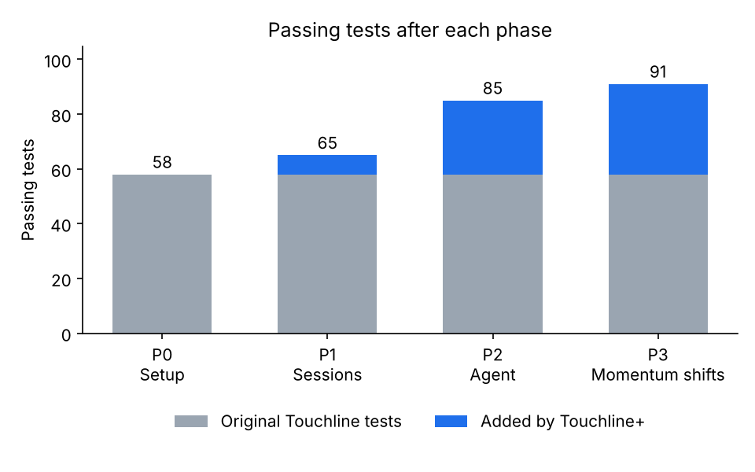

# Phase 3 — Explainable momentum shifts

Branch: `phase-3-momentum-shifts` (from `phase-2-agent`).

## What was built
- **Detection** (`app/shifts.py`): rolling 5-minute positive xT added per team; a shift happens when the leading side changes and the new gap stays ≥ 0.03 for ≥ 3 match minutes; shifts are ≥ 5 minutes apart; state resets each period. Settings: `GAME_SHIFT_THRESHOLD`, `GAME_SHIFT_WINDOW_SECONDS`, `GAME_SHIFT_HOLD_SECONDS`, `GAME_SHIFT_DEBOUNCE_SECONDS`.
- **Explanation**: top 3 actions by xT added in the window, grouped by `possession` into sequences, players involved, plus a template narration with cited event IDs.
- **SSE** `momentum_shift` event `{minute, period, from_team, to_team, magnitude, sequences, players, narration, cited_event_ids, chain, …}`, also stored in the session and visible to the agent via `get_momentum`.
- **Frontend**: arrow markers on the momentum chart; shift notes in the AI timeline; clicking a shift note, a marker, or an AI note with citations lights up the chain on the pitch with numbered, animated arrows; a **Clear highlight** control.

## Files touched
| File | Doc |
| --- | --- |
| `app/shifts.py` (new) | [doc](../files/app/shifts.py.md) |
| `app/replay.py`, `app/sessions.py`, `app/main.py`, `app/config.py` | [replay](../files/app/replay.py.md), [sessions](../files/app/sessions.py.md), [main](../files/app/main.py.md), [config](../files/app/config.py.md) |
| `app/agent/tools.py` | [doc](../files/app/agent/tools.py.md) |
| `app/static/app.js`, `chat.js`, `style.css`, `index.html`, `overlay.html` | [app.js](../files/app/static/app.js.md), [chat.js](../files/app/static/chat.js.md), [style.css](../files/app/static/style.css.md), [index.html](../files/app/static/index.html.md), [overlay.html](../files/app/static/overlay.html.md) |
| `tests/test_shifts.py` (new) | [doc](../files/tests/test_shifts.py.md) |
| `README.md` | [doc](../files/README.md.md) |

## Architecture after this phase

Full diagrams: [architecture.md](../architecture.md).

## Main flow changed

## Measurements
Shifts detected in the 90-minute synthetic match by threshold:

## Test results
**91 passed** (85 + 6 new), 0 skipped; ruff clean. Frontend verified in Chromium with Playwright on the synthetic match: 2 shift notes and 2 markers at 32′ (120× speed); clicking a marker draws a 12-step chain; Clear restores the live view; no JavaScript errors (the only console error is the expected 503 from AI notes with no API key).

## Decisions to review
- The shift metric is **positive xT added over 5 minutes** (not the original capped momentum proxy), because it links directly to the cited actions.
- The first time a team leads (no previous leader) also counts as a shift with `from_team: null` ("took control").
- A shift's `minute` is when it is confirmed (so it never references later events); `since_minute` is when the takeover started.
- Narration is a deterministic template rather than an LLM call: free, instant and always cited. The LLM can still explain shifts through `get_momentum`.
- Push still blocked (403).

## Open issues
- Threshold tuned on synthetic data only; check on real StatsBomb matches.
