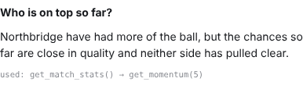
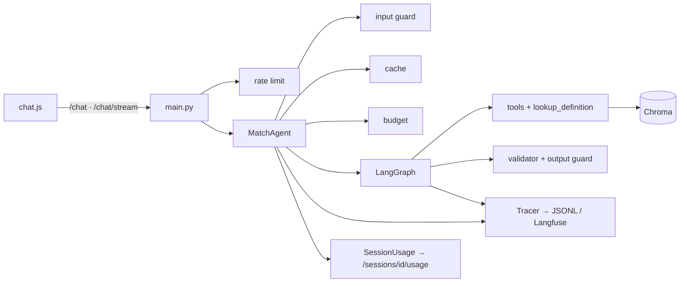
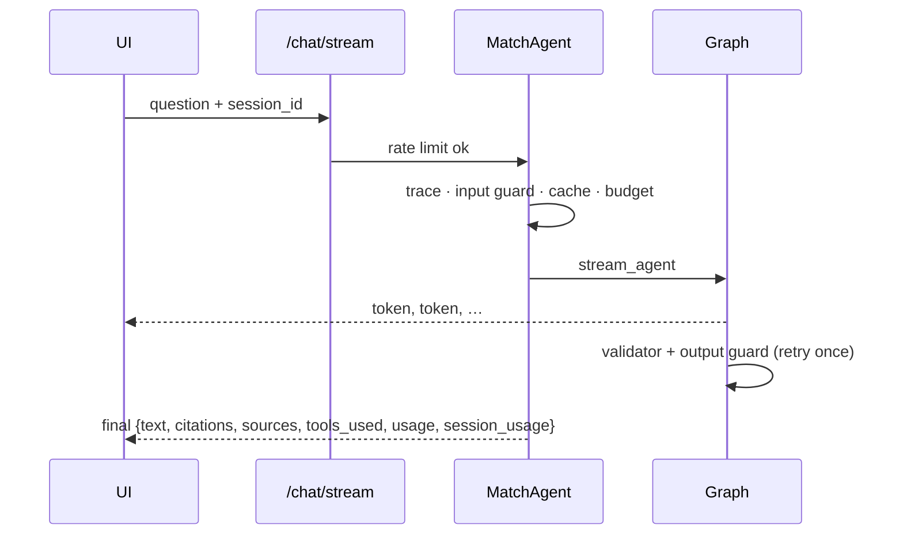
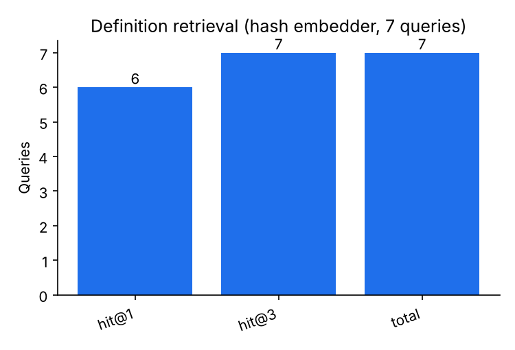
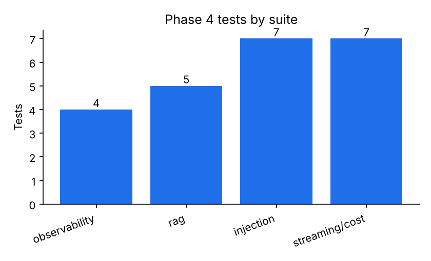
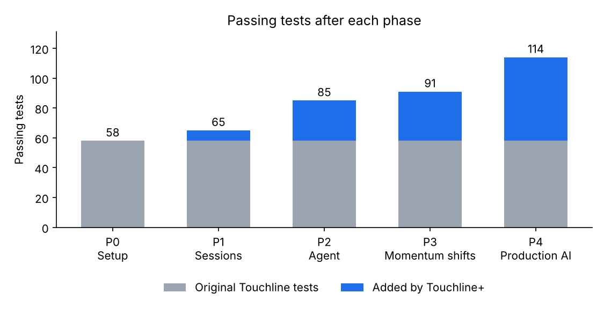

# Phase 4 — Production AI engineering layer

Branch: `phase-4-production-ai` (from `phase-3-momentum-shifts`).

## What was built
**4.1 Observability** — `app/observability.py`: one trace per question/note tagged with session, match, agent and provider; spans for each model call (tokens, cost, latency), each tool call (args, result size, duration), answer and validator; events for guard flags and cache hits. Backends: local `logs/traces.jsonl` (default), Langfuse when keys are set, otherwise no-op. Guide: [docs/observability.md](../observability.md).

**4.2 RAG** — `knowledge/` corpus (7 sourced definition files), `app/rag/` (heading-aware chunking with overlap, `fastembed` / `gemini` / `hash` embedders, persistent Chroma store with a pgvector note, `python -m app.rag.ingest`, lazy knowledge base). New agent tool `lookup_definition(query)`; answers must cite the retrieved source files (`cited_sources`, enforced by the validator).

**4.3 Guardrails** — `app/guardrails.py`: question length, per-session rate limit, injection flags (recorded, not dropped) with a prompt reminder, refusals for secret/system-prompt and off-topic requests, `<question>`/`<tool_result>` data delimiting, output checks (secret values, system-prompt passages, wrong scorelines, future minutes) on top of the citation validator. Threat model: [docs/security.md](../security.md).

**4.4 Streaming and cost** — `POST /chat/stream` (SSE `token` → `final`, or `reset`/`error`), UI renders tokens live (`/chat` unchanged for timeline notes); LRU+TTL answer cache keyed by normalized question, match, minute bucket, mode and model (`cached: true` + trace event); price table and per-session token/cost totals at `GET /sessions/{id}/usage`, shown in the UI; per-session budget → 402.

## Files touched
| File | Doc |
| --- | --- |
| `app/observability.py`, `app/guardrails.py`, `app/usage.py` (new) | [observability](../files/app/observability.py.md), [guardrails](../files/app/guardrails.py.md), [usage](../files/app/usage.py.md) |
| `app/rag/*` (new) | [package](../files/app/rag/__init__.py.md) |
| `knowledge/*.md` (new) | [corpus](../files/knowledge/README.md.md) |
| `app/agent/graph.py`, `tools.py`, `service.py` | [graph](../files/app/agent/graph.py.md), [tools](../files/app/agent/tools.py.md), [service](../files/app/agent/service.py.md) |
| `app/main.py`, `app/config.py`, `app/sessions.py` | [main](../files/app/main.py.md), [config](../files/app/config.py.md), [sessions](../files/app/sessions.py.md) |
| `app/static/chat.js`, `app/static/style.css` | [chat.js](../files/app/static/chat.js.md), [style.css](../files/app/static/style.css.md) |
| tests: `test_observability.py`, `test_rag.py`, `test_injection.py`, `test_streaming.py` (new); `conftest.py`, `test_agent.py` | [obs](../files/tests/test_observability.py.md), [rag](../files/tests/test_rag.py.md), [injection](../files/tests/test_injection.py.md), [streaming](../files/tests/test_streaming.py.md), [conftest](../files/tests/conftest.py.md), [agent](../files/tests/test_agent.py.md) |
| `Pipfile`, `Pipfile.lock`, `.env.example`, `.gitignore`, `README.md` | [Pipfile](../files/Pipfile.md), [.env.example](../files/.env.example.md), [.gitignore](../files/.gitignore.md), [README](../files/README.md.md) |
| `docs/observability.md`, `docs/security.md` (new) | — |

## Architecture after this phase

Full diagrams: [architecture.md](../architecture.md).

## Main request flow changed

## Measurements

Browser check (Chromium, synthetic match, fake streaming model): text appeared incrementally (partial answer visible 0.6 s in), final answer with `used: get_match_stats() → get_momentum(5)` and `LangGraph + Gemini · … · 3,720 tokens · $0.0014` (two answers in the session: an automatic note plus the question); no JS errors; the JSONL trace contained generation and tool spans.

## Test results
**114 passed** (91 + 23 new), 0 skipped; ruff clean.

## Decisions to review
- **Prices are placeholders** (`app/usage.py`): Gemini `gemini-3.8-flash` $0.30/$2.50 and GPT-4.1 mini $0.40/$1.60 per 1M tokens; Ollama $0. Verify against current provider pricing (`GAME_MODEL_PRICES`).
- **Default budget** $0.10 per replay session; **rate limit** 10 questions per minute per session (covers timeline notes too).
- **fastembed could not be verified**: Hugging Face downloads are blocked in this container. It remains the default as specified; set `GAME_RAG_EMBEDDER=hash` for fully offline hosts. Run `pipenv run python -m app.rag.ingest` once before using `lookup_definition`.
- Secret and system-prompt requests and clearly off-topic questions are **refused before** any model call (cheaper and deterministic); other injection flags only tighten the prompt.
- The optional model-based injection check was **not** implemented (it would double model calls); the pattern detector plus output checks are in place.
- The cache key includes the match id (not only question + clock bucket + mode + provider) so two matches at the same minute never share answers.
- Streaming and caching, cost and tracing apply to the LangGraph agent; the original `maf` workflow is unchanged (non-streaming; the UI falls back to `/chat`).
- Langfuse uses the SDK's v3+ OpenTelemetry API (`start_observation`, `propagate_attributes`), verified against langfuse 5.1 with a fake client only.
- Push still blocked (403).

## Open issues
- No live test with Langfuse, fastembed, Gemini or Ollama (no keys/network access).
- Session usage, cache and rate limits are in-memory per process.
